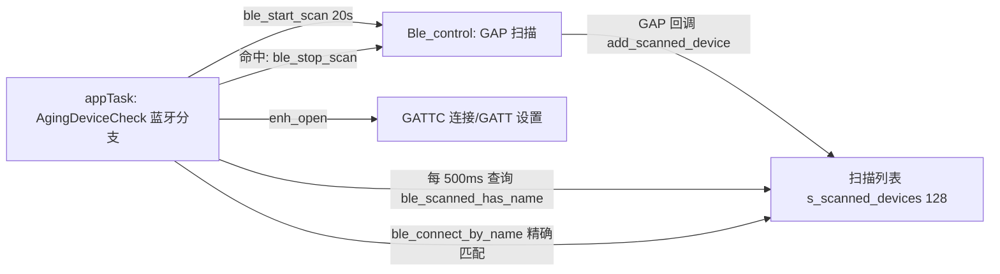

## 用户需求

现场 BLE 设备密集，网关经常扫不到已配置好的目标设备（名称为 PN，如 `PR100V22643110968368`），导致老化无法启动。需要优化扫描侧，使目标设备能被稳定发现。

## 现状依据

- 上一轮日志：15 轮"扫描 10s → 按名连接"循环中 13 轮打印 `Device 'PR100V22643110968368' not found in scan results`；仅 2 轮扫到（RSSI -49/-48），建链后 2.3s 以 `HCI rsn 0x3E` 失败。
- 广播信道（37/38/39）被大量设备占满，目标广播/扫描响应包反复碰撞丢失。
- 扫描完成后才发起连接，目标被扫到后仍要等到 10s 扫描结束，可连窗口容易错过。

## 已确认的取舍

- 单轮扫描延长到 **20s**（总窗口约 9 分钟，接受失败判定变慢）。
- 只做扫描侧优化：**不缓存设备地址、不改连接方式**（仍按名称精确匹配后连接）。
- 多台网关同屋场景忽略，不做扫描相位错峰。

## 核心功能

- 单轮扫描 10s 提升到 20s，增大单轮捕获概率。
- 扫描过程中一旦发现目标名称，立即停止扫描并马上发起连接，把"发现→建链"延迟从最多 20s 压缩到 0.5s 内。
- 扩充扫描结果列表容量，避免密集现场设备超过上限后目标被静默丢弃。
- 限制扫描结果打印数量，避免密集现场大量串口输出拖慢蓝牙回调。


## 技术栈

沿用现有工程：ESP-IDF v5.4.4、Bluedroid（GAP/GATTC）、FreeRTOS、C。不引入新依赖、不新增源文件（因此无需改 `main/CMakeLists.txt`）。

## 实现思路

仅改扫描侧，三类改动叠加：

1. **单轮扫描 20s**：`appTask.c` BLE 分支的 `ble_start_scan(10)` 改为 `ble_start_scan(BLE_AGING_SCAN_SECONDS)`，新增 `#define BLE_AGING_SCAN_SECONDS 20`；`BLE_SCAN_WAIT_TIMEOUT_MS` 由常量改为派生式 `(BLE_AGING_SCAN_SECONDS + 10) * 1000`，保证"超时 > 扫描时长"这一不变量在编译期自动成立，避免以后调扫描时长忘记同步超时。

2. **扫描中命中即连**：Ble_control 新增无日志的只读查询 `bool ble_scanned_has_name(const char *name)`（互斥锁内 `strcmp` 精确匹配，不打印，避免轮询刷屏）。`appTask` 的扫描等待循环由 1000ms 休眠改为每 `BLE_TARGET_POLL_INTERVAL_MS`（500ms）查询一次：
   - 命中：打印一条日志 → `ble_stop_scan()` → `ScanComplete = false` → 直接进入原有连接流程（跳过"扫描已完成"判定）；
   - 未命中：继续等到 `ScanComplete` 或超时，逻辑与现状一致。
   
   关键点：提前命中不能落到 `!scan_completed` 的失败分支，也不能让上一轮残留的 `ScanComplete` 影响本轮（每次 `ble_start_scan()` 前先清 `ScanComplete`）。

3. **列表容量与日志开销**：`MAX_SCAN_DEVICES` 50 → 128（数组在 `EXT_RAM_BSS`，增量约 6KB PSRAM）；`ble_scan_complete_cb` 的逐设备 `printf` 限制为前 10 条 + 总数摘要，避免密集现场每轮数千字节串口输出阻塞 GAP 回调上下文。

明确保持不变（属于约束，不是遗漏）：扫描仍为 `BLE_SCAN_TYPE_ACTIVE`、`BLE_SCAN_DUPLICATE_DISABLE`——主动扫描是获取扫描响应中完整名称的前提，关闭重复过滤才能让每次广播都触发扫描请求以重试取得名称；名称匹配仍为 PN 全名 `strcmp`；连接失败后 3s 退避、`AGING_DEVICE_CHECK_MAX_ATTEMPTS=25`、共存优先策略均沿用上一轮实现。

## 执行要点

- **时序**：成功轮 ≈ 发现时刻（≤20s）+ 建链（<1s）；失败轮 ≈ 20s 扫描 + 2s 循环尾延迟 ≈ 22s，25 轮约 9.2 分钟，与用户接受的 9 分钟量级一致。
- **竞态**：`ScanComplete` / `BleConnectComplete` 由 Bluedroid 回调置位、CPU1 老化任务轮询读取，沿用现有 volatile 模式；`ble_scanned_has_name()` 必须持 `s_device_list_mutex`，因为写入发生在 GAP 回调上下文。
- **不新增阻塞点**：查询接口只做一次线性扫描（≤128 项、每 500ms 一次），复杂度可忽略；不要在 GAP 回调里加打印或 NVS 操作。
- **日志**：命中提前连接新增一条 INFO（便于现场确认优化生效）；`Found device [n]` 保持每个新设备一次，不做降级，避免丢失现场可观测性；扫描结果打印限流到 10 条。
- **影响面控制**：不改 MQTT/JSON 契约、NVS schema、分区表、SPIFFS 配置；不改 `ble_connect_by_name()` 的连接语义（仅在其前面增加"提前触发"）。

## 架构与模块关系



## 目录结构

```
main/
├── Communication/
│   └── Ble_control/
│       ├── Ble_control.h   # [MODIFY] 新增 ble_scanned_has_name() 声明（只读、无日志、精确匹配语义说明）
│       └── Ble_control.c   # [MODIFY] MAX_SCAN_DEVICES 50→128 并注释 PSRAM 增量与实际饱和风险；
│                           #          实现 ble_scanned_has_name()（持锁线性查找、不打印）；
│                           #          补充注释说明 ACTIVE + DUPLICATE_DISABLE 是获取完整名称所必需，禁止改动
└── Task/
    └── appTask.c           # [MODIFY] 新增 BLE_AGING_SCAN_SECONDS=20 / BLE_TARGET_POLL_INTERVAL_MS=500；
                            #          BLE_SCAN_WAIT_TIMEOUT_MS 改为派生宏并更新注释；
                            #          蓝牙分支: 启动扫描前清 ScanComplete，ble_start_scan(20)；
                            #          等待循环内每 500ms 检查目标名，命中即停扫并立即连接（不走未完成失败分支）；
                            #          ble_scan_complete_cb 打印限流为前 10 条 + 总数
```

## 关键接口

```c
/* 目标名称是否已出现在本轮扫描结果中（精确匹配，不打印日志）。
 * GAP 回调上下文写列表、CPU1 老化任务读，内部持 s_device_list_mutex。
 * 仅用于扫描期间提前命中判断，不发起连接（连接仍由 ble_connect_by_name 完成）。 */
bool ble_scanned_has_name(const char *name);
```

## 验证

1. `idf.py -B build/mesh-lite -D SDKCONFIG=build/mesh-lite/sdkconfig build` 通过，无新增告警。
2. 宿主回归 `python3 tests/test_mqtt_uplink.py` 保持通过（本次不改该模块，用于防误伤）。
3. 实机验收：日志出现 `BLE scanning started for 20 seconds`；命中时出现提前停扫日志，且 `Connecting to device:` 早于 `Scan completed`；`not found in scan results` 轮次明显下降；`0x3E` 次数下降。


## Agent Extensions
### Skill
- **embedded-coding-standard**
  - Purpose: 在改动定稿前对齐工程 `.ai/coding-standard.md` 本地规范（命名、注释语言、错误处理、RTOS 上下文约束），并对新增的查询接口与扫描循环变更做一次规范自查。
  - Expected outcome: 输出符合工程既有风格的实现要点与潜在规范问题清单，避免引入与既有代码风格冲突的写法。
