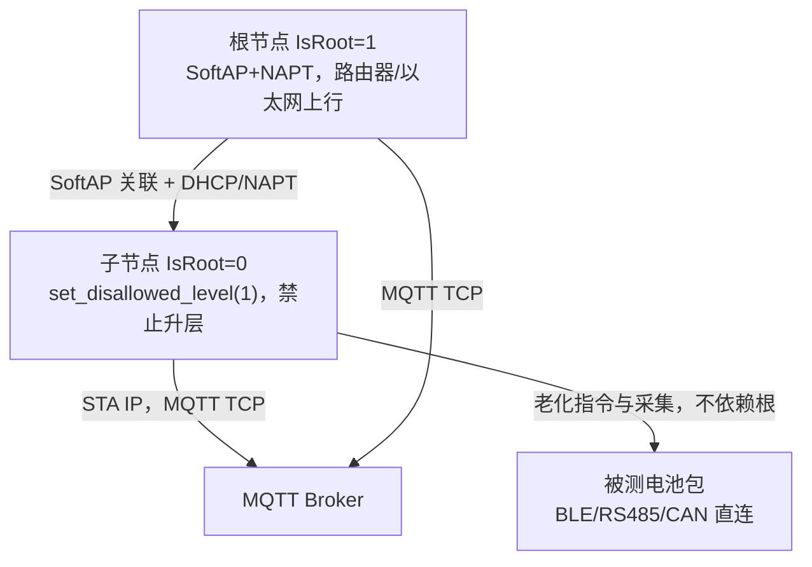
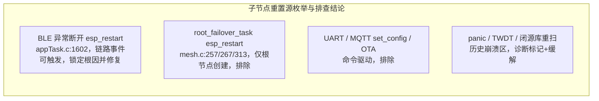
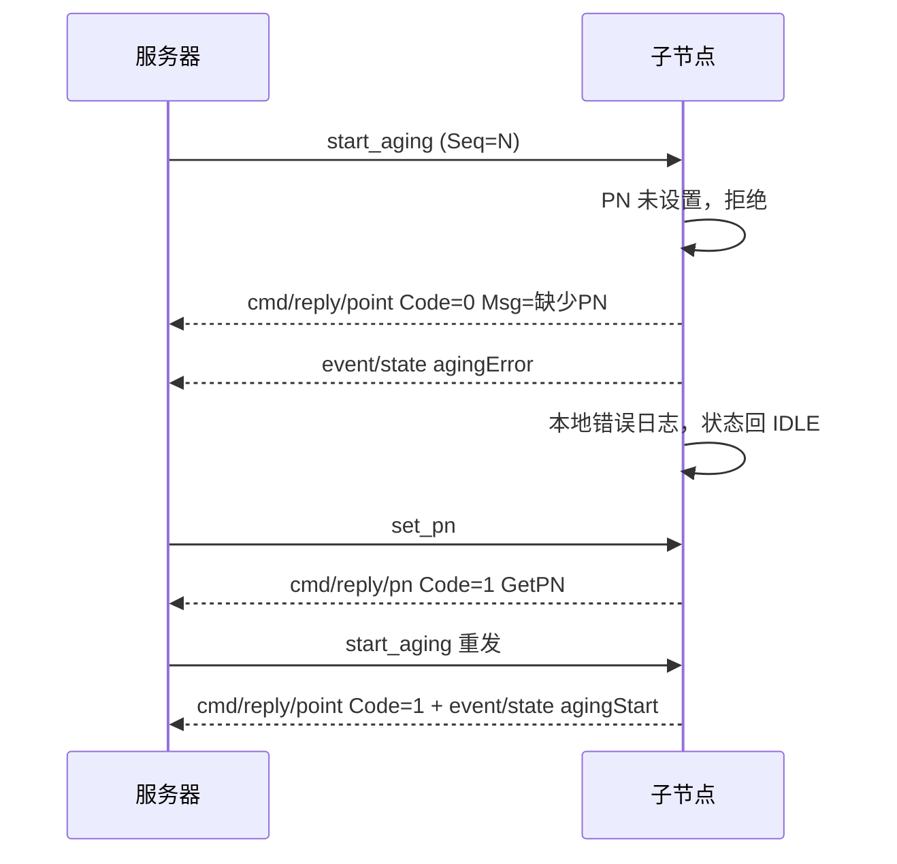

## 产品概述
ESP32-S3 电池老化测试网关固件：ESP-Mesh-Lite 组网（根/子节点同一固件，仅 baseconfig 中 IsRoot 不同），子节点 STA 经根节点 SoftAP+NAPT 获得 IP 后独立连接 MQTT；同时驱动被测电池包（BLE/RS485/CAN）执行多步充放电老化，采样数据落 SQLite 并经 MQTT 上传。

## 核心功能
### 1. 根节点掉线时子节点不得异常重启
- 文档化根/子节点依赖关系（父节点关联、DHCP/NAPT 上行、MQTT 可达性；老化执行本身与根无关）、保活机制（mesh-lite 父节点重连/重扫、MQTT keepalive 根60s/子15s、子重连2s、LWT）、故障转移策略（主备路由器切换仅限根的 root_failover_task；子节点禁止升层为根，依赖 mesh 自动重挂）、重启后恢复流程（NVS 断点续化 + RUNNING/WAIT_PN 恢复 + SQLite pushed=0 补发）。
- 根因定位：枚举子节点全部重置源并按触发条件排除命令驱动源，锁定唯一可由链路事件触发的重启点——BLE 异常断开的无条件 esp_restart；叠加根消失后 mesh 反复重扫造成的射频争用（BLE 老化链路）与闭源 mesh-lite 重扫路径的历史崩溃记录。
- 处理逻辑：BLE 异常断开不再整机重启，改为老化任务内优雅中止（上报 agingError、清理并回 IDLE）；新增子节点 mesh 健康监视任务（仅观测：层级/关联/网络标志/堆内存周期打印，用于证实调度正常）；调优 mesh-lite 父节点重连与重扫节奏；BLE 扫描等待加超时；根掉线期间老化继续本地执行并缓存，恢复后自动补发。

### 2. start_aging 缺 PN 的老化异常处理（用户确认：直接拒绝回 IDLE）
- 收到老化指令且 PN 未设置时：立即经 MQTT 返回老化异常——cmd/reply/point（Code=0，Msg 明示缺少 PN、请先下发 set_pn），同时上报 event/state 的 agingError 与错误日志；不缓存命令、不写 RecordId，状态回到 IDLE，服务器需按 set_pn→start_aging 顺序重新下发。
- 补齐异常处理链路：参数校验顺序调整（Data/ProgramId 前置，RecordId 仅通过 PN 门后写入）、本地+MOTT 错误日志、旧固件遗留 WAIT_PN 挂起状态的清理。


## 技术栈
- ESP-IDF v5.4.4 / C / FreeRTOS 双核（业务任务固定 CPU1，create_cpu1_task + task_config.h 的 LG_* 常量）
- esp-mesh-lite 1.0.2 + iot_bridge 1.0.1（managed_components，mesh 核心闭源，仅端口层开源）
- esp-mqtt、cJSON、SQLite(FATFS)、NVS(SelfRecovery)、SPIFFS(配置)
- 无测试套件：验证手段为编译 + 串口观察；编码规范权威为 .ai/coding-standard.md

## 实现方案
总策略：设计先行（两份设计文档落地仓库根目录，沿用 DUAL_NET_DESIGN.md 惯例）→ 最小侵入代码修复 → 规范审查 + 编译 → 版本号跟进。

根因定位方法论（可复现、可证伪）：
1. 枚举子节点固件全部重置源：app 层 6 处 esp_restart 调用点 + 闭源库路径 + panic/TWDT；
2. 按触发条件排除：root_failover_task（mesh.c:257/267/313，仅 IsRoot=1 创建）、UART 本地命令、MQTT set_config、OTA 成功（均为命令驱动，根掉线不可触发）；
3. 剩余唯一链路事件驱动源 = ble_disconnect_cb 的无条件 esp_restart（appTask.c:1602），与用户观察的"根消失→子重启"及 mesh 重扫射频争用（BLE 老化链路）吻合；
4. 闭源库重扫路径有历史崩溃记录（LoadProhibited during mesh scan retry / StoreProhibited，coredump 已启用），无法源码修复，采用"降低暴露频率 + 可观测性 + 诊断标记"缓解。

修复三件套：
- 去重启化：BLE 断开回调只置 volatile 标志 + ESP_LOGW（不碰存储/MQTT/任务删除）；老化任务主循环消费标志，若当前老化设备为 Bluetooth 则 agingError + Aging_Task_Abort_And_Delete 优雅中止，否则忽略；
- 可观测性：mesh.c 新增子节点 mesh_health_task（5s 周期，父丢失时打印 level/Network_Flag/断开原因/内部堆余量，健康时 60s 心跳），WIFI_EVENT_STA_DISCONNECTED 补记 reason；
- 节奏调优：esp_mesh_lite_set_wifi_reconnect_interval(10s, 3 次, 30s 重扫)（库默认 5s×2 次后每 10s 重扫）。

PN 守卫：start_aging 分支重排序为 Data→ProgramId→RUNNING 拒绝→PN 门→RecordId→启动；PN 门未过即拒绝并回 IDLE（含清理旧固件遗留 WAIT_PN 挂起与 Aging.json）；删除 cache_pending_start_command 及其唯一调用（start_aging 不再产生挂起命令），保留 NVS 旧标志的恢复兼容路径。

性能与可靠性：
- 新增监视任务栈 3072B、优先级 2、5s 周期，对老化采集/上传热路径零影响；
- 重扫 10s→30s：根恢复后发现时间最坏 30s（根自身重启恢复通常更慢），换取 BLE 老化链路稳定与闭源扫描路径暴露下降；
- 回调上下文安全：BLE 回调仅置标志；存储/MQTT/任务删除全部在老化任务上下文执行；监视任务只读状态+打日志，无任何重启动作。

## 架构设计







## 执行注意
- 修改 C 前先读 .ai/coding-standard.md（AGENTS.md 强制要求，本地规范优先于内置模板）；
- 复用 create_cpu1_task() 与 LG_* 常量；新任务仅子节点创建，根节点运行行为零变化（爆炸半径控制）；
- JSON 协议键名与中文契约不动；回复 Msg 沿用现有英文风格（与 "Aging already started, ignoring new command" 等一致）；
- RecordId 写入移到 PN 门之后，避免拒绝路径产生 NVS 副作用；
- 删除 cache_pending_start_command 前全局确认无其他引用（现仅 start_aging 分支一处调用）；
- 不新增源文件，无需改 main/CMakeLists.txt SRCS；
- 日志防刷屏：父丢失 5s 一条（掉线属异常态可接受），健康 60s 心跳；
- 修改 data/ 配置才需完整 flash；本次不改 data/。

## 目录结构
```
ESP32Aging/
├── CHILD_NODE_ROOT_LOSS_DESIGN.md      # [NEW] 设计文档：依赖/保活/故障转移/恢复/根因定位/修复/诊断标记/实机验收
├── AGING_CMD_PN_GUARD_DESIGN.md        # [NEW] 设计文档：PN缺失异常处理/消息格式/补偿机制/兼容性
├── version.txt                         # [MODIFY] 版本号递增（沿用 git 提交序列，如 0.0.1.13）
├── main/
│   ├── Task/
│   │   ├── task_config.h               # [MODIFY] 新增 LG_STACK_MESH_HEALTH/LG_PRIO_MESH_HEALTH
│   │   └── appTask.c                   # [MODIFY] BLE断开去重启化+老化任务协同中止；start_aging PN门；BLE扫描等待超时；删除 cache_pending_start_command
│   └── Communication/Internet/Mesh/
│       └── mesh.c                      # [MODIFY] 父节点重连/重扫节奏调优；STA断开原因日志；子节点 mesh_health_task
```

## 关键代码结构
仅列接口级定义（实现由执行阶段完成）：

```c
/* appTask.c：PN 缺失拒绝与 BLE 事件解耦 */
#define AGING_START_REPLY_NO_PN "Aging start rejected: PN is not set, please send set_pn first"
static volatile bool s_ble_abnormal_disconnect;          /* BLE 回调置位，老化任务主循环消费 */
static void reject_start_aging_missing_pn(int start_seq); /* 清理遗留WAIT_PN + cmd/reply/point + agingError + 错误日志 */

/* mesh.c：重连节奏与子节点健康监视（仅 IsRoot==0 创建，只观测不重启） */
#define MESH_PARENT_RETRY_INTERVAL_SEC 10
#define MESH_PARENT_RETRY_COUNT 3
#define MESH_RESCAN_INTERVAL_SEC 30
static void mesh_health_task(void *arg);
```


## Agent Extensions
### Skill
- **embedded-coding-standard**
  - Purpose: 在编译验证前，按项目本地规范 .ai/coding-standard.md（本地文件优先于内置模板）审查本次 C 改动：BLE 回调上下文安全性（仅置标志，不做存储/MQTT/任务删除）、volatile 并发标志与老化任务的协作式中止、任务创建/删除与栈优先级常量、函数返回值处理、命名与单位后缀。
  - Expected outcome: 改动符合本地嵌入式 C 规范，无上下文误用、并发与资源管理回归，形成可追溯的审查记录后再进入编译。
