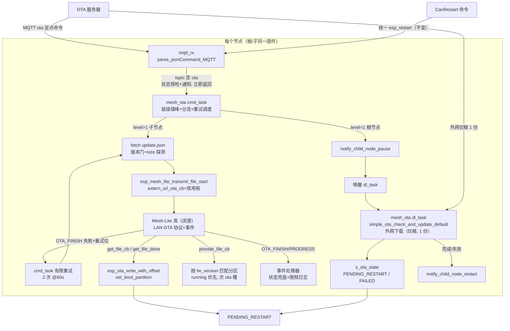

## 产品概述

启用 Mesh-Lite 原生 OTA 分发后：子节点收到 OTA 命令时只经 Mesh 内部逐级向父节点/根节点请求固件（**不再走外网下载兜底**），已持有目标版本的节点经 mesh 内 LAN OTA 文件传输把固件分发给请求方；根节点自身升级时先暂停子节点 OTA 请求，再走外网下载唯一一份固件，完成后恢复子节点。5 个子节点同时 OTA 时，根节点 WiFi 出口流量从 5 份（约 10.5 MB）降为 1 份（约 2.1 MB），其余经 Mesh 内部通道分发。

## 核心功能

- **配置启用**：开启 Mesh-Lite OTA 组件开关，关闭其自动重启（保持本项目"下载完成后等 CanRestart 统一点火"的既有流程）
- **层级分流**：MQTT ota 命令进入新适配层；子节点强制走 mesh 内请求/分发（extern_url_ota_cb 为禁用桩，mesh 内全链路拿不到即失败，不外网兜底）；根节点走"暂停子节点 + 外网下载 1 份 + 恢复子节点"
- **Mesh 内文件传输**：提供方按版本号匹配分区读出固件（running 分区优先，次为已下载未重启的 ota 槽）、接收方乱序安全写入 OTA 分区、完成回调设置启动分区
- **可靠性补偿（无兜底后的必要措施）**：层级错峰启动（按 mesh 层级延迟发起请求，给根留下载窗口）+ 根下载期间 pause/restart 排队 + 失败有限自动重试
- **命令执行解耦**：外网下载与 mesh 请求均从 MQTT 接收任务移出，由适配层双任务执行，解决 OTA 期间命令通道阻塞、队列溢出与栈不足问题
- **状态机兼容**：下载完成进入"等待重启"态；PENDING_RESTART/RUNNING 期间重复命令被拒绝；失败重试耗尽后可由服务器重新下发命令
- **版本门与体积探测**：升级前仍比对服务器版本（不新则跳过）；子节点用轻量请求探测固件 Content-Length 作为分发 size 参数
- **可诊断性**：OTA 开始/进度/结束事件落日志，失败带原因码；日志可区分"mesh 内分发"与"外网下载（仅根）"

## 行为效果

- 子节点日志只出现 mesh 内请求/接收记录，不出现固件外网下载；根节点日志出现暂停/恢复子节点与外网下载记录
- 根节点 WiFi 出口仅 1 份固件流量；笔记本热点下整体耗时与成功率显著改善
- CanRestart 统一点火行为不变：各节点全部就绪后统一下发重启，重启后运行新固件
- 旧固件节点（未刷入本次改动）不受影响：命令本就定点下发，旧节点走原外网路径


## Tech Stack Selection

- **固件框架**：ESP-IDF v5.4.4（`/home/wbb/espidf/esp-idf-mesh-lite` 副本）、C（贴近 c99）、FreeRTOS、cJSON —— 与现有工程完全一致，不引入任何新组件
- **复用现有资产**：`espressif/mesh_lite` 1.0.2 的 OTA 子模块（`CONFIG_ESP_MESH_LITE_OTA_ENABLE`，当前关闭）、`iot_bridge` 1.0.1、`esp_http_client`、`app_update`（esp_ota_*）、`esp_event`、`lg_url_build()` 运行时 URL 机制
- **分层**：新增适配层 `mesh_ota.c/h` 作为 Mesh-Lite OTA 与项目 OTA 模块（ota.c）之间唯一耦合点；ota.c 继续独占"外网下载"职责，仅做最小拆解暴露复用点

## Implementation Approach

**策略：适配层 + 层级分流 + 双任务解耦 + 错峰重试。**

1. **开关**：sdkconfig 启用 Mesh-Lite OTA；`OTA_AUTO_RESTART=n` 保持 CanRestart 外部点火；`OTA_DATA_LEN=1376`/`OTA_WND_DEFAULT=8256` 用组件默认值（窗口 6 包，是 get_file_cb 必须乱序安全写入的原因）
2. **适配层注册**：`mesh_ota_init()` 在 `mesh_init_Custom()` 成功后调用（appTask.c mesh_init 成功分支内，早于 net_init 任务建 MQTT），注册 LAN OTA 文件传输三回调 + OTA 事件处理器，并创建 cmd_task/dl_task 两个 CPU1 任务（所有节点统一创建，子的 dl_task 空闲待命）
3. **命令入口**：appTask.c 的 ota 分支改为 `mesh_ota_handle_mqtt_command()` —— 仅状态预检（PENDING_RESTART 忽略 / RUNNING 拒绝）+ 通知 cmd_task 后立即返回，mqtt_rx 不再被任何下载阻塞
4. **cmd_task 分流**（按 `esp_mesh_lite_get_level()`）：
   - 子节点（level>1）：层级错峰延迟（level×30s + 0-10s 抖动）→ 拉取 update.json → 版本比较（不新则回 IDLE）→ 探测固件 Content-Length 作 size → `esp_mesh_lite_transmit_file_start()`，**`extern_url_ota_cb` 传禁用桩（打 WRN 日志 + 返回 ESP_FAIL，不传字面 NULL，防闭源库无条件解引用）**；库内部逐级向父请求，直到根；全链路无目标版本 → 禁用桩返回失败 → OTA_FINISH(FAIL)
   - 根节点（level=1）：`esp_mesh_lite_ota_notify_child_node_pause()` → 唤醒 dl_task 执行外网下载 → 等待完成事件 → `esp_mesh_lite_ota_notify_child_node_restart()` 恢复子节点
5. **dl_task**：唯一执行 `simple_ota_check_and_update_default()` 的任务，**只服务根节点路径**。子节点无 extern 回调执行，死锁面消失；dl_task 独立保证根下载期间 cmd_task 仍活着处理重试调度
6. **失败自动重试**：OTA_FINISH(非 SUCCESS) 事件处理器按 reason 置 FAILED + 打日志 + 通知 cmd_task 重试位；cmd_task 重试调度（默认 2 次、间隔 60s，重试走完整分流流程含重新拉取 update.json）；耗尽置 FAILED 等服务器重发命令。根路径 dl_task 失败同样汇入该调度器
7. **三回调**：
   - `provide_file_cb`：按 `param->fw_version` 找匹配 app 分区——先 running 分区读 `esp_app_desc_t.version` 比对，再遍历 ota_0/ota_1 另一槽比对（覆盖"根已下载未重启"态，CanRestart 流程下这是主要场景）；读取范围按镜像实际大小钳位，64KB 对齐产生的 padding 段填 0xFF
   - `get_file_cb`：首次调用时惰性 `esp_ota_begin(part, OTA_SIZE_UNKNOWN, &handle)`，随后一律 `esp_ota_write_with_offset(handle, data, size, offset)`（窗口传输可能乱序，offset 为权威位置）
   - `get_file_done_cb`：`esp_ota_end()` + `esp_ota_set_boot_partition()` → 置 PENDING_RESTART；失败 `esp_ota_abort`
8. **事件驱动状态机**：OTA_FINISH(SUCCESS) 仅当状态仍为 RUNNING 时兜底置 PENDING_RESTART（get_file_done 通常已置，防库事件顺序不确定）；PROGRESS 每 10% 一条限频日志
9. **移除 `wait_ota_allow`**：子节点不外网、根无更高层，该检查成为死代码，ota.c 下载循环不加任何改动

**关键决策与取舍**：
- 禁用桩而非字面 NULL：闭源库对 NULL 回调的行为（失败事件？挂起？崩溃？）不可见，桩函数保证任何路径都有确定返回值与日志；若实机发现库根本不会在"全链路无固件"时调用 extern 回调，则桩自然不被触发，无害
- 三层时序保护（错峰 + pause/restart + 重试）：无兜底后"子请求到达时根未就绪"从性能问题升级为可靠性问题；错峰给根下载窗口，pause/restart 让库内排队（官方范式，可靠性待验证），重试吸收残余时序抖动
- `esp_ota_begin` 惰性化：子节点无法预知库走哪条内部路径，首次 get_file_cb 时开启最稳
- provide_file_cb 双路径（running + ota 槽）：闭源库"节点已有固件"的判定条件不可见（可能只认运行中版本）。代码侧最大化可服务性；**实际生效路径必须实机验证**，这是整个方案成立的关键 gate
- RUNNING 态命令防护：异步化后第二条 ota 命令可能在 RUNNING 期间到达（原同步实现天然免疫），新增拒绝逻辑防双下载
- 无运行期 malloc：EventGroup/Mutex 用 `xEventGroupCreateStatic`/`xSemaphoreCreateMutexStatic`（对齐 mqtt_app.c 的 StaticSemaphore 范式）；句柄互斥用短临界区 mutex

**性能与复杂度**：
- 出口流量 N×2.1MB → 1×2.1MB；Mesh 内 ESPNOW 传输不占根 STA；根节点 SoftAP 每槽 5 子不变
- 热路径为 get_file_cb（每包 1376B 一次 flash 写）：库任务串行驱动，无锁竞争；provide_file_cb 每次匹配分区需读 2 个 esp_app_desc_t（各 256B，毫秒级）
- 潜在瓶颈：根节点同时向 5 子分发时 SoftAP 射频争用（属 mesh 内部分发，不再经根 WiFi）；OTA_DATA_LEN 上限 1376 为组件约束，无需调
- 50 节点扩展：三层树（1 根 + 9 中间 + 40 叶子）下请求逐级穿透，中间父级联缓存分摊带宽；错峰步长建议按层级下调窗口时间标定

## Implementation Notes

- **sdkconfig 再生成坑**（MESH_LITE_MIGRATION.md 已记录）：`sdkconfig.defaults` 不覆盖已存在的 `build/mesh-lite/sdkconfig`，必须备份删除后重新生成，再编译
- **`esp_ota_write_with_offset` 已确认存在**（esp_ota_ops.h:171，IDF v5.4.4），注释明确覆盖"packets arrive out of order"场景；同 handle 不得与 `esp_ota_write` 混用
- **`create_cpu1_task` 是 appTask.c 的 static 函数**，mesh_ota.c 不可用；适配层内部用 `xTaskCreatePinnedToCore(..., LG_APP_CPU_CORE)` + init-once 静态守卫（封装性优先，不为复用把该 helper 提权到公共头）
- **回调上下文**：get/provide/done 与事件处理器均可能来自闭源库内部任务或 esp_event 任务，注释必须标注"不可假设调用方、不得长时间持锁、esp_ota_* 可重入"；重试决策只经任务通知传递，不在事件上下文跑重流程
- **闭源库关键 gate（最高风险）**：根节点下载完成进入 PENDING_RESTART **但未重启**时，子节点请求能否让库回调到 root 的 provide_file_cb（从 ota 槽供数）。若库只认"运行中版本匹配"，mesh 分发在本项目"延迟重启"设计下将不生效。 contingent 选项（需用户决策）：A. 根本身下载后立即重启（偏离统一点火设计，子节点仍延迟）；B. 回退每子外网兜底（老问题复发）。先用 1 根 1 子最小拓扑专测此项，再推进全场验收
- **日志规范**：mesh_ota 用独立 TAG "mesh_ota"；不打密码/PII；PROGRESS 限频；失败日志必须带 reason 枚举值；子节点外网路径被禁用的桩命中打 WRN
- **兼容性**：未刷新固件的旧节点只认自己 topic 的 ota 命令走原外网路径，mesh OTA 消息不应影响它们（定点下发，风险低，需验证）
- **改动爆炸半径**：appTask.c 仅动 ota 命令分支与 mesh_init 成功分支各一处；ota.c 仅增函数不改下载语义；不改 MQTT/老化/SQLite 任何路径

## Architecture Design



**模块关系**：`mesh_ota.c/h` 为新增适配层，唯一同时依赖 esp_mesh_lite 与 ota.h 的文件，对外只暴露 init/handle_mqtt_command/get_state 三接口；ota.c 保持外网下载与状态机所有权，新增暴露四个复用点；appTask.c 仅两处接线；task_config.h 新增两个任务常量。

## Directory Structure

```
project-root/
├── sdkconfig.defaults                      # [MODIFY] 追加 Mesh-Lite OTA 5 项 Kconfig（AUTO_RESTART=n）
├── version.txt                             # [MODIFY] 0.0.1 → 0.0.2（使新固件可被服务器更高版本触发 OTA 验证）
├── main/
│   ├── CMakeLists.txt                      # [MODIFY] SRCS 增加 mesh_ota.c（APP/OTA 已在 INCLUDE_DIRS）
│   ├── APP/OTA/
│   │   ├── mesh_ota.h                      # [NEW] 适配层接口：init / handle_mqtt_command / get_state；注释标注调用上下文与阻塞性
│   │   ├── mesh_ota.c                      # [NEW] 适配层实现：三文件传输回调 + 禁用桩 + OTA 事件处理器 + cmd/dl 双任务 + 层级错峰 + 有限重试；静态分配同步对象；分区匹配与越界钳位
│   │   ├── ota.h                           # [MODIFY] 暴露 simple_ota_metadata_t、simple_ota_fetch_metadata / simple_ota_probe_firmware_size / simple_ota_version_is_newer / simple_ota_set_state
│   │   └── ota.c                           # [MODIFY] 拆解上述函数（复用 download_metadata_json/parse_metadata_json/build_url/apply_https_config）；下载语义不变
│   └── Task/
│       ├── appTask.c                       # [MODIFY] ota 命令分支改调 mesh_ota_handle_mqtt_command；mesh_init_Custom 成功分支内调 mesh_ota_init
│       └── task_config.h                   # [MODIFY] 新增 LG_STACK/LG_PRIO_MESH_OTA、LG_STACK/LG_PRIO_MESH_OTA_DL
└── MESH_LITE_OTA_INTEGRATION.md            # [NEW] 设计决策、闭源库 gate 结论、实机验收记录
```

## Key Code Structures

适配层对外接口（mesh_ota.h）：

```c
/* 调用上下文: app_task_init, mesh_init_Custom 成功后调用一次; 建任务+注册回调+注册事件; 不可重入 */
esp_err_t mesh_ota_init(void);

/* 调用上下文: mqtt_rx 任务; 非阻塞, 立即返回; 内部状态预检后通知 cmd_task */
void mesh_ota_handle_mqtt_command(void);

/* 调用上下文: 任意任务; 无阻塞; 透传 ota.c 状态机当前值 */
simple_ota_state_t mesh_ota_get_state(void);
```

子节点发起配置（cmd_task 内组装，extern 为禁用桩是本次核心变更）：

```c
/* 子节点禁用外网兜底: 命中即失败, 由重试调度吸收; 不打 firmware URL 防日志泄露内网拓扑 */
static esp_err_t mesh_ota_extern_disabled(void)
{
    ESP_LOGW(TAG, "Mesh-internal firmware unavailable; external fallback disabled by design");
    return ESP_FAIL;
}

esp_mesh_lite_file_transmit_config_t cfg = {
    .type  = ESP_MESH_LITE_OTA_TRANSMIT_FIRMWARE,
    .size  = probed_size_bytes,                    /* Content-Length 探测值 */
    .extern_url_ota_cb = mesh_ota_extern_disabled, /* 强制 mesh 内路径 */
};
strlcpy(cfg.fw_version, metadata.version, sizeof(cfg.fw_version));
esp_err_t err = esp_mesh_lite_transmit_file_start(&cfg);  /* 返回值必须处理 */
```

ota.h 新增暴露的复用点（ota.c 实现，供 mesh_ota.c 与 dl_task 使用）：

```c
typedef struct {                                   /* 从 ota.c 内部提升到 ota.h */
    char version[SIMPLE_OTA_VERSION_MAX_LEN];
    char file[SIMPLE_OTA_FILENAME_MAX_LEN];
} simple_ota_metadata_t;

esp_err_t simple_ota_fetch_metadata(simple_ota_metadata_t *out);              /* 阻塞, 任务上下文 */
esp_err_t simple_ota_probe_firmware_size(const char *file_name, size_t *out); /* open+fetch_headers 即关, 不下载 body */
bool     simple_ota_version_is_newer(const char *server_version);             /* 无阻塞 */
void     simple_ota_set_state(simple_ota_state_t state);                      /* 无阻塞 */
```


## Agent Extensions

### Skill
- **embedded-coding-standard**
  - Purpose: 在实现与自审阶段对照本工程 `.ai/coding-standard.md` 本地规范（头文件自包含、返回值必须处理、共享状态同步、禁止运行期 malloc、错误路径不得为空、注释标注调用上下文等），审查新增的 mesh_ota.c/h 与改动的 ota.c/appTask.c/task_config.h
  - Expected outcome: 新代码通过本地规范自查（静态分配同步对象、句柄互斥短临界区、回调上下文注释齐全、错误路径均有记录/上报），无规范项回归
