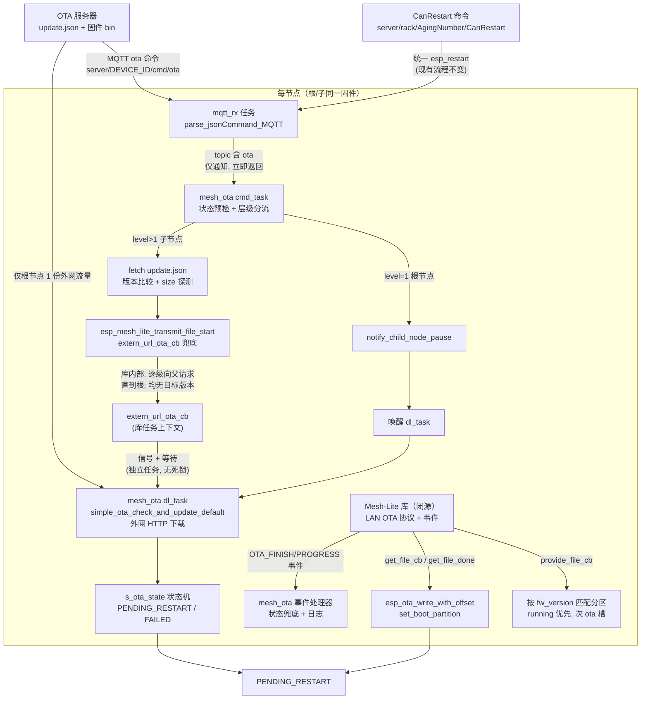

## 产品概述

启用 Mesh-Lite 原生 OTA 分发后：子节点收到 OTA 命令时，先经 Mesh 内部逐级向父节点/根节点请求固件；已持有目标版本的节点（根或中间节点）通过 Mesh 内 LAN OTA 文件传输把固件分发给请求方；只有 Mesh 内全链路都找不到目标版本时，才回退到现有的外网 HTTP 下载。根节点自身升级时先暂停子节点 OTA 请求，再走外网下载，完成后恢复子节点。5 个子节点同时 OTA 时，根节点 WiFi 出口流量从 5 份固件（约 10.5 MB）降为 1 份（约 2.1 MB），其余经 Mesh 内部通道分发。

## 核心功能

- **配置启用**：开启 Mesh-Lite OTA 组件开关，关闭其自动重启（保持本项目"下载完成后等 CanRestart 统一点火"的既有流程）
- **入口分流**：MQTT ota 命令统一进入新适配层；子节点走 Mesh 内请求（外网下载仅作兜底），根节点走"暂停子节点 + 外网下载 + 恢复子节点"
- **Mesh 内文件传输**：实现提供方（按版本号匹配分区读出固件）、接收方（乱序安全写入 OTA 分区）、完成回调（设置启动分区）三个回调
- **下载执行解耦**：外网下载从 MQTT 接收任务移出，由独立任务执行，解决 OTA 期间命令通道阻塞、队列溢出与栈不足问题
- **状态机兼容**：下载完成进入"等待重启"态；重复命令与运行中命令被拒绝；失败态可由服务器重新下发命令重试
- **版本门与体积探测**：升级前仍检查服务器版本（不新则跳过）；子节点通过轻量请求探测固件体积作为分发参数
- **可诊断性**：OTA 开始/进度/结束事件落日志，失败带原因码；关键路径日志可区分"Mesh 内分发"与"外网兜底"

## 行为效果

- 子节点日志出现 Mesh 内请求/接收固件的记录，根节点日志出现暂停/恢复子节点与外网下载记录
- 根节点 WiFi 出口仅 1 份固件流量；笔记本热点下整体耗时与成功率显著改善
- CanRestart 统一点火行为不变：各节点全部就绪后统一下发重启，重启后运行新固件
- 旧固件节点（未刷入本次改动）不受影响：命令本就定点下发，旧节点走原外网路径


## Tech Stack Selection

- **固件框架**：ESP-IDF v5.4.4（`/home/wbb/espidf/esp-idf-mesh-lite` 副本）、C（贴近 c99）、FreeRTOS、cJSON —— 与现有工程完全一致，不引入任何新组件/新依赖
- **复用现有资产**：`espressif/mesh_lite` 1.0.2 的 OTA 子模块（`CONFIG_ESP_MESH_LITE_OTA_ENABLE`，当前为关闭态）、`iot_bridge` 1.0.1、`esp_http_client`、`app_update`（esp_ota_*）、`esp_event`、`lg_url_build()` 运行时 URL 机制
- **分层**：新增适配层 `mesh_ota.c/h` 作为 Mesh-Lite OTA 与项目 OTA 模块（ota.c）之间的唯一耦合点；ota.c 继续独占"外网下载"职责，仅做最小拆解暴露复用点

## Implementation Approach

**策略：适配层 + 层级分流 + 双任务解耦。**

1. **开关**：sdkconfig 启用 Mesh-Lite OTA；`OTA_AUTO_RESTART=n` 保持 CanRestart 外部点火；`OTA_DATA_LEN=1376`/`OTA_WND_DEFAULT=8256` 用组件默认值（窗口 6 包，是 get_file_cb 必须乱序安全写入的原因）
2. **适配层注册**：`mesh_ota_init()` 在 `mesh_init_Custom()` 成功后调用（appTask.c:5398 之后的 else 分支内，早于 net_init 任务建 MQTT），注册 LAN OTA 文件传输三回调 + OTA 事件处理器，并创建两个 CPU1 任务
3. **命令入口**：appTask.c 的 ota 分支改为 `mesh_ota_handle_mqtt_command()` —— 仅做状态预检（PENDING_RESTART/RUNNING 拒绝）+ 通知 cmd_task 后立即返回，mqtt_rx 不再被下载阻塞
4. **cmd_task 分流**（按 `esp_mesh_lite_get_level()`）：
   - 子节点（level>1）：拉取 update.json → 版本比较（不新则回 IDLE）→ 探测固件 Content-Length 作 size → `esp_mesh_lite_transmit_file_start()`，`extern_url_ota_cb` 指向外网下载兜底
   - 根节点（level=1）：`esp_mesh_lite_ota_notify_child_node_pause()` → 唤醒 dl_task 执行外网下载 → `esp_mesh_lite_ota_notify_child_node_restart()` 恢复子节点
5. **dl_task**：唯一执行 `simple_ota_check_and_update_default()` 的任务。同时服务根节点直连路径与子节点 extern 兜底路径——**这是避免死锁的关键**：子节点路径下 cmd_task 阻塞在 `transmit_file_start()` 内，若 extern 回调再等待 cmd_task 则死锁；dl_task 独立故无环
6. **三回调**：
   - `provide_file_cb`：按 `param->fw_version` 找匹配 app 分区——先 running 分区，再遍历 ota_0/ota_1 槽读 `esp_app_desc_t.version`（覆盖"根已下载未重启"态，CanRestart 流程下这是主要场景）；超出镜像实际大小的对齐 padding 段填 0xFF
   - `get_file_cb`：首次调用时惰性 `esp_ota_begin(part, OTA_SIZE_UNKNOWN, &handle)`，随后一律 `esp_ota_write_with_offset(handle, data, size, offset)`（窗口传输可能乱序，offset 为权威位置）
   - `get_file_done_cb`：`esp_ota_end()` + `esp_ota_set_boot_partition()` → 置 PENDING_RESTART
7. **事件驱动状态机**：`ESP_MESH_LITE_EVENT` 的 OTA_FINISH(SUCCESS) 仅当状态仍为 RUNNING 时兜底置 PENDING_RESTART；失败按 reason 置 FAILED 并打日志；PROGRESS 每 10% 一条限频日志
8. **外网下载循环抢占检查**：`perform_http_ota()` 读循环中周期性调用 `esp_mesh_lite_wait_ota_allow()`（`#ifdef` 守卫），更高层节点开始 OTA 时中止本次外网下载让位 Mesh 内分发（官方推荐范式）

**关键决策与取舍**：
- extern_url_ota_cb 不内联执行下载而唤醒 dl_task：闭源库内部任务栈大小不可知，HTTP 下载链（esp_http_client + 2048B 缓冲 + cJSON + esp_ota）栈需求高；且必须与 transmit_file_start 的调用者分离避免死锁
- `esp_ota_begin` 惰性化：子节点无法预知走 LAN 还是外网兜底；若库已回退 extern 而句柄已开，先在回调里 `esp_ota_abort()` 再走外网，杜绝双 begin 冲突
- provide_file_cb 双路径（running + ota 槽）：闭源库"节点已有固件"的判定条件不可见（可能是运行版本匹配，也可能含已下载槽）。代码侧最大化可服务性；**实际生效路径必须实机抓日志验证**，若子节点仍全部走外网兜底（功能正确但不省带宽），需评估让根节点也走 transmit_file_start 的变体
- RUNNING 态命令防护：异步化后第二条 ota 命令可能在 RUNNING 期间到达（原同步实现天然免疫），新增拒绝逻辑防双下载
- 无运行期 malloc：EventGroup/Mutex 用 `xEventGroupCreateStatic`/`xSemaphoreCreateMutexStatic`（对齐 mqtt_app.c 的 StaticSemaphore 范式）；句柄互斥用短临界区 mutex

**性能与复杂度**：
- 出口流量 N×2.1MB → 1×2.1MB；Mesh 内 ESPNOW 传输不占根 STA；根节点 SoftAP 每槽 5 子不变
- 热路径为 get_file_cb（每包 1376B 一次 flash 写）：单线程库任务串行，无锁竞争；provide_file_cb 每次匹配分区需读 2 个 esp_app_desc_t（各 256B，毫秒级）
- 潜在瓶颈：根节点同时向 5 子分发时 SoftAP 射频争用（属 Mesh 内部分发，不再经根 WiFi）；OTA_DATA_LEN 最大 1376 为组件上限，无需调

**技术债务规避**：不改 ota.c 现有外部下载主链路语义（URL/校验/状态机/双槽），只做函数拆解与 `#ifdef` 守卫的新增；Mesh-Lite API 全部经适配层隔离，库升级只碰 mesh_ota.c

## Implementation Notes

- **sdkconfig 再生成坑**（MESH_LITE_MIGRATION.md 已记录）：`sdkconfig.defaults` 不覆盖已存在的 `build/mesh-lite/sdkconfig`，必须备份删除后重新生成，再编译
- **`esp_ota_write_with_offset` 已确认存在**（esp_ota_ops.h:171，IDF v5.4.4），且注释明确"packets arrive out of order"场景；不得与 `esp_ota_write` 混用（同 handle 只用前者）
- **OTA_SIZE_UNKNOWN 语义**：begin 时整槽擦除；与现有 perform_http_ota 行为一致，可接受
- **`create_cpu1_task` 是 appTask.c 的 static 函数**，mesh_ota.c 不可用；适配层内部用 `xTaskCreatePinnedToCore(..., LG_APP_CPU_CORE)` + init-once 静态守卫（封装性优先，避免为复用把该 helper 提权到公共头）
- **回调上下文**：get/provide/done 与 extern_url_ota_cb 均可能来自闭源库内部任务（非 cmd_task/dl_task/mqtt_rx），注释必须标注"不可假设调用方、不得长时间持锁、esp_ota_* 可重入"
- **闭源库风险控制**：所有新代码对库行为只依赖已文档化的 API 契约；lib/*.a 内部逻辑（如"有固件"判定、OTA_FINISH 与 get_file_done 的先后）按防御式编程处理（状态只升不降地兜底），实机验证前不假设
- **日志规范**：复用各模块 TAG（mesh_ota 用独立 TAG "mesh_ota"）；不打密码/PII；PROGRESS 限频；失败日志必须带 reason 枚举值
- **兼容性**：`#ifdef CONFIG_ESP_MESH_LITE_OTA_ENABLE` 守卫 ota.c 内新增的 wait_ota_allow 调用，保证关闭该 Kconfig 时工程仍可编译
- **改动爆炸半径**：appTask.c 仅动 ota 命令分支与 mesh_init 成功分支各一处；ota.c 仅增函数与一处循环检查；不改 MQTT/老化/SQLite 任何路径

## Architecture Design



**模块关系**：
- `mesh_ota.c/h`：新增适配层，唯一同时依赖 esp_mesh_lite 与 ota.h 的文件；对外只暴露 init/handle_mqtt_command/get_state 三接口
- `ota.c/ota.h`：保持外网下载与状态机所有权；新增暴露 fetch_metadata / probe_firmware_size / set_state / version_is_newer 四个复用点与一处 wait_ota_allow 检查
- `appTask.c`：命令入口改调适配层；mesh_init 成功后调 mesh_ota_init；CanRestart 分支不动
- `task_config.h`：新增两个任务的 LG_STACK/LG_PRIO 常量

## Directory Structure

```
project-root/
├── sdkconfig.defaults                      # [MODIFY] 追加 Mesh-Lite OTA 5 项 Kconfig（OTA_AUTO_RESTART=n）
├── version.txt                             # [MODIFY] 0.0.1 → 0.0.2（发版决策：使 USB 预刷的新固件可被服务器更高版本触发 OTA 验证）
├── main/
│   ├── CMakeLists.txt                      # [MODIFY] SRCS 增加 mesh_ota.c（APP/OTA 已在 INCLUDE_DIRS，无需重复加）
│   ├── APP/OTA/
│   │   ├── mesh_ota.h                      # [NEW] 适配层接口：mesh_ota_init / mesh_ota_handle_mqtt_command / mesh_ota_get_state；注释标注调用上下文与阻塞性
│   │   ├── mesh_ota.c                      # [NEW] 适配层实现：三文件传输回调 + OTA 事件处理器 + cmd_task/dl_task 双任务；静态分配同步对象；分区匹配与越界钳位
│   │   ├── ota.h                           # [MODIFY] 暴露 simple_ota_metadata_t、simple_ota_fetch_metadata / simple_ota_probe_firmware_size / simple_ota_set_state / simple_ota_version_is_newer
│   │   └── ota.c                           # [MODIFY] 拆解上述函数（复用 download_metadata_json/parse_metadata_json/build_url/apply_https_config）；perform_http_ota 读循环加 #ifdef 守卫的 wait_ota_allow 周期检查
│   └── Task/
│       ├── appTask.c                       # [MODIFY] ota 命令分支改调 mesh_ota_handle_mqtt_command；mesh_init_Custom 成功分支内调 mesh_ota_init
│       └── task_config.h                   # [MODIFY] 新增 LG_STACK_MESH_OTA/LG_PRIO_MESH_OTA、LG_STACK_MESH_OTA_DL/LG_PRIO_MESH_OTA_DL
└── docs/（或根目录）
    └── MESH_LITE_OTA_INTEGRATION.md        # [NEW] 设计决策、闭源库风险与待验证项、实机验收记录（可选，随验证结果补充）
```

## Key Code Structures

适配层对外接口（mesh_ota.h，仅声明）：

```c
/* 调用上下文: app_task_init, mesh_init_Custom 成功后调用一次; 建任务+注册回调+注册事件; 不可重入 */
esp_err_t mesh_ota_init(void);

/* 调用上下文: mqtt_rx 任务; 非阻塞, 立即返回; 内部做状态预检后通知 cmd_task */
void mesh_ota_handle_mqtt_command(void);

/* 调用上下文: 任意任务; 无阻塞; 透传 ota.c 状态机当前值 */
simple_ota_state_t mesh_ota_get_state(void);
```

ota.c 需暴露的复用点（ota.h 新增声明，ota.c 实现）：

```c
typedef struct {                     /* 从 ota.c 内部提升到 ota.h */
    char version[SIMPLE_OTA_VERSION_MAX_LEN];
    char file[SIMPLE_OTA_FILENAME_MAX_LEN];
} simple_ota_metadata_t;

/* 下载 update.json 并解析（默认 URL, 复用现有链路）; 阻塞, 任务上下文 */
esp_err_t simple_ota_fetch_metadata(simple_ota_metadata_t *out_metadata);

/* 对固件文件做 open + fetch_headers 探测 Content-Length 后即关闭, 不下载 body; 阻塞 */
esp_err_t simple_ota_probe_firmware_size(const char *file_name, size_t *out_size_bytes);

/* 服务器版本是否新于本地运行版本（复用内部 semver 比较）; 无阻塞 */
bool simple_ota_version_is_newer(const char *server_version);

/* 状态机置值（mesh 路径驱动同一状态机, 单一事实源）; 无阻塞 */
void simple_ota_set_state(simple_ota_state_t state);
```

LAN OTA 回调签名（组件既有契约，mesh_ota.c 实现，须严格遵守）：

```c
/* 提供方: 按 param->fw_version 匹配分区读出; 库任务上下文, 不得持锁做 flash 读 */
static esp_err_t provide_file_cb(esp_mesh_lite_lan_ota_file_transfer_param_t *param);
/* 接收方: 惰性 esp_ota_begin + esp_ota_write_with_offset(param->offset); 短临界区 */
static esp_err_t get_file_cb(esp_mesh_lite_lan_ota_file_transfer_param_t *param);
/* 完成: esp_ota_end + esp_ota_set_boot_partition + 置 PENDING_RESTART; 失败 abort */
static esp_err_t get_file_done_cb(void);
/* 外网兜底: 唤醒 dl_task 并等待其完成; 库任务上下文, 返回外网下载结果 */
static esp_err_t extern_url_ota_cb(void);
```

传输发起配置（cmd_task 内组装）：

```c
esp_mesh_lite_file_transmit_config_t cfg = {
    .type  = ESP_MESH_LITE_OTA_TRANSMIT_FIRMWARE,
    .size  = probed_size_bytes,          /* Content-Length 探测值 */
    .extern_url_ota_cb = extern_url_ota_cb,
};
strlcpy(cfg.fw_version, metadata.version, sizeof(cfg.fw_version));
esp_mesh_lite_transmit_file_start(&cfg);
```


## Agent Extensions

### Skill
- **embedded-coding-standard**
  - Purpose: 在实现与自审阶段对照本工程 `.ai/coding-standard.md` 本地规范（头文件自包含、返回值必须处理、共享状态同步、禁止运行期 malloc、错误路径不得为空、注释标注调用上下文等），审查新增的 mesh_ota.c/h 与改动的 ota.c/appTask.c
  - Expected outcome: 新代码通过本地规范自查（静态分配同步对象、句柄互斥短临界区、回调上下文注释齐全、错误路径均有记录/上报），无规范项回归
