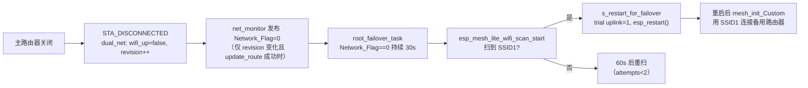

## 问题描述

根节点（IsRoot=1，仅 WiFi 上行、以太网硬件未使用）在主 WiFi 正常连接后，关闭主路由器，设备不切换到备用 WiFi（SSID1/WIFI_PS1）。需结合 mesh.c 的 `root_failover_task` 故障转移链与 dual_net.c 的网络标志裁决链，定位断点并修复。

## 功能链路（现状，已代码核实）

## 核心排查假设（按优先级）

| # | 假设 | 验证方法 |
|---|---|---|
| H1 | `root_failover_task` 从未创建（设备实际 baseconfig 的 SSID1/WIFI_PS1 无效，条件不满足**静默不创建**，无任何日志） | 开机日志 + 启动时打印创建结果 |
| H2 | Network_Flag 未按时归零（根节点标志由 dual_net 独占发布；`update_route` 因快照后 revision 又变返回 false，发布被跳过） | 打印标志发布/跳过与 revision 变化 |
| H3 | 扫描链断点：`esp_mesh_lite_wifi_scan_start` 被拒（WRN Failover scan）；或 `scan_end_cb` 先于 `WIFI_EVENT_SCAN_DONE` 置 `s_scan_active=false` 导致结果被 `if (!s_scan_active) return;` 全部丢弃 | 打印 scan_start/end 回调与 SCAN_DONE 的先后、扫描返回码、AP 列表匹配过程 |
| H4 | 重启切换链断点：`s_restart_for_failover` 未置位；或 NVS `mesh_net/uplink` 历史值为 1 导致 `other_ssid` 指向主 SSID（已关闭）→ 永远扫不到 | 打印 uplink_index、other_ssid、restart 决策 |
| H5 | `s_failover_attempts`（RTC_NOINIT 跨重启残留）已达 2 进入 5 分钟冷却；或观察窗口不足（30s+60s 节奏） | 打印 attempts 与 cooldown 状态 |
| H6 | mesh-lite 闭源库行为：库内重连/重扫风暴与外部扫描相互影响 | 日志时序分析，必要时升级组件验证 |

## 修复后验收标准

- 关闭主路由器后，根节点在 30s 触发扫描、90s 内完成重启切换，备用路由器接入后 `Network_Flag=1`、MQTT 重连、`mesh_health` 心跳恢复
- 全程串口日志可完整解释每一次扫描/重启决策（可诊断性）
- 主路由器恢复后可按需切回（或维持备用，行为确定且文档化）
- 子节点行为不受影响（无网线场景）

## 技术栈与方案

平台：ESP-IDF v5.4.4 / ESP32-S3 / C / FreeRTOS；复用现有 mesh.c、dual_net.c 架构，不引入新组件、不动 sdkconfig、不改 mesh-lite 闭源库。

**总策略：诊断先行，修复随后。** 当前代码路径的行为断点无法从静态阅读完全确定（尤其 H3 的 scan 回调时序与 H2 的 revision 竞争概率），因此分两阶段：第一阶段只加「零行为变更」的诊断日志并实机复现取证，用日志在假设树上定位唯一根因；第二阶段仅针对确认的根因实施最小修复，再做规范审查与回归。

### 第一阶段：仪器化诊断（不改行为）

1. **mesh.c**（`root_failover_task` 及其回调链）：
   - 任务创建点：打印创建结果（成功/失败）与 `valid_router(SSID1,WIFI_PS1)` 判定值——消除 H1 的「静默」；
   - `root_failover_task` 主循环：每轮打印 `Network_Flag`、`lost_since` 时长、`s_failover_attempts`、`s_uplink_index`/`other_ssid`、`s_scan_requested`/`s_scan_active`、`dual_net_has_eth_ip()`（掉线态 5s 一条，恢复后 60s 一条，防刷屏）；
   - `scan_done_handler`：打印 SCAN_DONE 到达、`s_scan_active` 值、AP 总数、逐条 SSID 与匹配结果；
   - `scan_start_cb`/`scan_end_cb`：打印进入/退出，用于证实 H3 的回调先后顺序；
   - 重启决策：打印 `s_restart_for_failover` 置位与 `s_trial_uplink_index`。
2. **dual_net.c**：
   - `dual_net_publish_network_flag()` 已有变更日志；补充：`update_route` 因 revision 竞争返回 false 时打印一次（限频：同因 10s 内一次），验证 H2；
   - `wifi_event_handler` 已有 reason 日志，补充 `wifi_generation`/`revision` 值便于时序对齐。

### 第二阶段：按根因修复（预置分支）

- **H1 确认**：配置项修正 + 将「任务未创建」从静默改为开机 ESP_LOGE（可诊断性）。
- **H2 确认**：`update_route` 的 revision 竞争改为「本轮回合内重试一次再发布」或「标志发布与 revision 应用解耦」，保证断开态标志必然归零（含单测/宿主回归思路）。
- **H3 确认（时序缺陷）**：`s_scan_active` 改原子并在 `scan_done_handler` 内按「本次 SCAN_DONE 是否对应外部请求」判定（用单调递增的 scan 代次 `scan_generation` 匹配 start/done），彻底摆脱对回调先后顺序的依赖；同时处理扫描被库拒绝时的退避重试。
- **H4 确认**：重启后 trial 逻辑修复；NVS uplink 与 `other_ssid` 指向增加日志与防呆（uplink=1 时应扫主 SSID，属预期行为，需文档化）。
- **H5 确认**：attempts 冷却逻辑校正（掉电/重启复位语义文档化；冷却期日志明示）。
- **H6 确认**：若为库行为，采取规避（如调整外部扫描时机至库重连间隙）并记录限制；评估升级 mesh_lite 组件。

### 可靠性与性能

- 诊断日志全部走现有 `ESP_LOGx` + TAG（mesh_lite_app / dual_net），按状态限频，不新增任务/队列/锁；
- 修复阶段改动限制在 mesh.c / dual_net.c 两个文件，根/子节点共用固件——子节点路径（`root_failover_task` 与 dual_net 均不运行）零影响；
- `Network_Flag` 与 `s_scan_active` 等共享量按本地规范用原子/短临界区，volatile 不单独用作同步。

### 避免技术债

- 仪器化日志在根因确认后保留（降频版），作为该链路的长期可诊断性资产，不提交「临时 print」；
- 修复同时更新 MESH_LITE_MIGRATION.md 的「实机验收 4」为本次确认的行为契约。

### Skill
- **embedded-coding-standard**
  - Purpose: 修复阶段（第二阶段）按工程 `.ai/coding-standard.md`（本地规范权威）与 `.em_skill.json` 已确认规则组合（CERT C + FreeRTOS + Local coding standard）审查 C 改动：共享状态同步（Network_Flag / s_scan_active / scan 代次）、任务上下文与回调上下文 API 边界、错误路径非空、返回值处理、日志限频与命名单位后缀。
  - Expected outcome: 修复符合本地嵌入式 C 规范，无并发/上下文误用与回归，形成可追溯审查记录后再编译。
