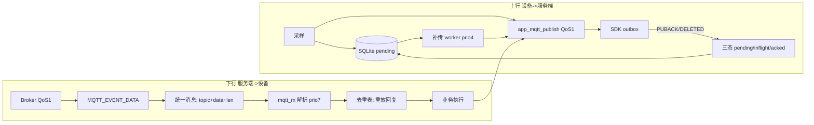

## 产品概述
ESP32Aging 设备端固件的 MQTT 可靠性改造。合并《MQTT_QoS_修改计划_设备端.md》（8 项变更 D1-1~D3-2）与《MQTT_QoS_独立分析_设备端.md》（7 条必改意见，已经代码逐条核实全部成立），按“先修数据身份与确认语义，再修接收承载，最后切换 QoS”的顺序分两期实施（0.0.3 / 0.0.4）。

## 核心功能
- 采样身份固化：SQLite/QueryResult 增加会话 RecordId 列并做探测式 schema 迁移；补传/点播 JSON 改用记录自身 RecordId，CurrentStep 序列化统一 1 基；旧记录隔离跳过并告警；IDNUM 增加轮次身份防 A→B→A 串批
- 接收链路加固：MQTT_EVENT_DATA 改统一消息封装（topic 随首片数据一起入队，消除双 FIFO 错配与孤立项）；接收队列 10→32 并纳入满溢计数与 10 秒诊断
- 命令去重重放：16 项去重表改为“不执行但重放上次回复”，缓存在回复构造后、发布前；覆盖 get_state 直连路径；不清表改时间窗口过期；修复回滚缺陷
- PUBACK 三态：pushed 区分 pending/inflight/acked，扩展 ack 捕获到业务发布，DELETED 回滚，重启恢复 inflight 重传
- 断线补传 worker：QueryUnpushedRecords 驱动的新任务，坏记录隔离、outbox 退避、上线唤醒 + 60 秒兜底轮询
- 协议清理与 QoS 切换：warn 改标准 JSON（2 处）；修 local_log 裸 tick bug；删除确认废弃的死订阅（保留 set_config）；存活订阅统一切 QoS 1 且 SUBACK 严格校验为 1

## 明确不做
- 发布侧 QoS 保持 1 不变（唯一例外 runtime 日志维持 QoS 0 尽力而为）
- clean_session 保持 1；不统一 MQTT 协议版本（设备 3.1.1 / 服务端 5.0）
- 不做平台侧入库对账；OTA 回滚改为“更高版本号还原版”发布（ota.c 阻止降级）

## 技术栈
- 固件：ESP-IDF（C）+ esp-mqtt 组件 + 自封装 SQLite（sqllib1/SqLite）+ FreeRTOS 双核（业务任务固定 CPU1）
- 构建：`cd /home/wbb/espidf/esp-idf-mesh-lite && . ./export.sh`，`IDF_SKIP_CHECK_SUBMODULES=1 idf.py -B build/mesh-lite -D SDKCONFIG=build/mesh-lite/sdkconfig build`；无测试套件，验证=编译+串口观察
- 复用既有设施：`app_malloc_prefer_psram`、`create_cpu1_task`、`task_config.h` 宏、`s_ack_map` 确认位图、10 秒压力诊断、探测式 schema 检测先例（SQLITE_SCHEMA_PROBE_FIX_V4.md）

## 实施方案（总策略）
四阶段递进，每阶段独立可编译、可灰度、可回滚：



关键决策与理由：
1. **P0 身份先行**：补传 JSON 当前在查询时用全局 RecordId 重建（sqllib1.c:183）+ 0 基工步（:184），与实时路径（Json_data.c:871 的 step+1）不一致；不先固化，补传 worker 必跨 PN 串批。
2. **统一消息封装**：双 FIFO 错配（Seq 非法不消费 topic，appTask.c:2426）与孤立项是根因；把 topic 嵌入数据消息首片、单队列消费，同时删除 Topic_queue，从结构上消除错配。扩容只治容量不治错配。
3. **去重不清表**：epoch 在 mqtt_app.c:371/400/726/787 递增，断线重连恰是服务端原 Seq 重试高概率场景；改时间窗口过期，容量 16→32（PSRAM 约 17 KB）。
4. **回复发布前缓存**：入队失败路径也要可重放；get_state（appTask.c:2682-2693）绕过辅助函数，需一并覆盖；修“history=NULL 时连防重一起关”的回滚缺陷。
5. **PUBACK 三态而非平台对账**：PUBACK 只到 Broker；pending/inflight/acked + DELETED 回滚 + 重启恢复即可覆盖掉电/outbox 过期/客户端销毁，成本远低于平台对账。
6. **订阅最后切 QoS 1**：队列未加固前切 1 会把“可观测丢”变成“静默丢 + 重传放大”；先删死订阅再切存活订阅。
7. **OTA 回滚修正**：ota.c:700-711 阻止降级，回滚必须用更高版本号的还原版固件。

## 性能与可靠性
- 内存预算（内部 RAM）：数据队列 32 槽 × 约 1092 B ≈ 35 KB（含 topic 字段），删除 Topic_queue 省 0.7 KB；净增约 +24 KB。门槛：实测 `largest_internal > 80 KB` 才用 32，否则降 20
- PSRAM：去重表 32 条 ≈ 17 KB；补传批缓冲 4 × QueryResult ≈ 18.8 KB
- 热点路径：mqtt_rx（prio 7）不被补传（prio 4）抢占；补传批间隔 100 ms 防打满 outbox 56 KB 准入预算
- 复杂度：去重线性扫 32 项；补传每批 4 条、SQLite 锁持有时短（单批）
- 验收原则（独立分析硬性要求）：必须同时验证采样完整性、RecordId/工步归属正确、动作只执行一次，不得只观察 PUBACK 或 queue_overflow=0

## 执行注意
- Schema 迁移用探测式列检测 + ALTER TABLE ADD COLUMN，沿用 V4 修复先例；迁移失败必须保留旧库可用并打错误
- 旧无 RecordId 记录：补传时跳过并发 warn（默认假设，待现场确认）
- IDNUM 轮次身份：实施前与服务端确认去重键是否含 RecordId；默认按“唯一键/查询加 RecordId 过滤”推进
- local_log 的 `vTaskDelay(100)` 是裸 tick（100 Hz 下每条约 1 秒、约 50 分钟独占 mqtt_rx），必修或删订阅
- set_config（appTask.c:2694-2714，清 SPIFFS + 重启）默认保留订阅并给 QoS 1
- 版本管理：version.txt 三段式（当前 0.0.2）；第一期 0.0.3（P0+P1+warn），第二期 0.0.4（P2+死订阅删除+QoS 1）；回滚=发布更高版本号还原版
- 日志：复用 ESP_LOGx 与现有 10 秒诊断，新增 queue_overflow 计数，不引入新日志通道
- 不新增源文件（避免 CMakeLists  wiring 风险）：补传 worker 放 appTask.c，去重表逻辑留 appTask.c，接收封装改 mqtt_app.c

## 架构设计
- 数据层：SQLite 单表增加 record_id 列；pushed 语义升级为三态；QueryResult 携带 RecordId
- 传输层：mqtt_app.c 负责统一消息封装、队列、确认位图扩展、订阅管理；appTask.c 负责命令去重/重放、业务回复、补传 worker
- 关注点分离：身份固化（SqLite/sqllib1/Json_data）、接收（mqtt_app）、命令与补偿（appTask）三段互不越界
- 向后兼容：schema 探测保证旧库可读；旧记录隔离不阻塞新记录补传

## 目录结构
```
ESP32Aging/
├── version.txt                                  # [MODIFY] 0.0.2 -> 0.0.3 -> 0.0.4（三段式，分两期发布）
├── main/
│   ├── DataStorage/SqLite/
│   │   ├── sqllib1.h                            # [MODIFY] QueryResult 增加 record_id 字段（采样会话身份）
│   │   ├── sqllib1.c                            # [MODIFY] db_build_data_report_json 改用 record->record_id；CurrentStep 序列化统一 1 基；fill_query_result_from_stmt 填充新列
│   │   ├── SqLite.c                             # [MODIFY] 探测式 schema 迁移（ADD COLUMN record_id）；InsertStructuredRecord 写入会话 RecordId；补传查询按 RecordId 过滤；坏记录隔离辅助；淘汰策略注释校核
│   │   └── SqLite.h                             # [MODIFY] 新增函数声明（补传/隔离/三态更新）
│   ├── APP/MQTT/
│   │   └── mqtt_app.c                           # [MODIFY] 统一消息封装（topic 嵌入数据消息首片，删 Topic_queue）；队列加深 10->32；queue_overflow 计数并入 10 秒诊断；ack 位图 capture 扩展至业务发布；SUBACK 严格校验 ==1；订阅宏 MQTT_SUBSCRIBE_QOS；删除 6 条死订阅
│   ├── Task/
│   │   ├── task_config.h                        # [MODIFY] 新增 LG_STACK/PRIO_MQTT_BACKFILL 宏（4096 / 4）
│   │   └── appTask.c                            # [MODIFY] 去重表改重放结构（PSRAM、时间窗口、发布前缓存、覆盖 get_state）；三态 pushed 写入与恢复；补传 worker 创建与唤醒；warn 改标准 JSON（2 处）；local_log 裸 tick 修复；IDNUM 轮次身份
│   └── Tool/
│       └── Json_data.c                          # [MODIFY] create_sensor_json 保持实时路径不变（1 基），确认与补传路径共用序列化约定
```

## 关键代码结构
```c
/* 1) QueryResult 增量（sqllib1.h）：采样会话身份，补传 JSON 不再依赖全局 RecordId */
typedef struct
{
    /* ...既有字段不变... */
    char record_id[/* 与全局 RecordId 等宽 */];   /* 新增：采样时固化的老化会话 RecordId */
} QueryResult;

/* 2) 去重/重放记录（appTask.c）：命中不执行，重放上次回复 */
typedef struct {
    int  seq;
    bool valid;
    TickType_t first_seen;      /* 时间窗口过期，替代随 epoch 清表 */
    char topic_suffix[16];      /* "point"/"state"/"pn"/"config"/"setlog" */
    char payload[512];          /* 原始回复 JSON，超长不缓存并降级告警 */
} MqttSeqRecord;

/* 3) 推送三态与补传接口 */
typedef enum { PUSH_PENDING = 0, PUSH_INFLIGHT = 1, PUSH_ACKED = 2 } push_state_t;
void mqtt_backfill_wake(void);  /* mqtt_app.c 在 MQTT_SETUP_DONE 调用，唤醒补传任务 */
```

## Agent Extensions
### SubAgent
- **code-explorer**
  - Purpose: 在 P0 schema 迁移与去重表改造时，以 medium  Thoroughness 梳理全部 QueryResult / db_build_data_report_json / InsertStructuredRecord / app_mqtt_publish 调用点，确认迁移与重放登记无遗漏
  - Expected outcome: 输出完整调用点清单与影响面，保证 schema 加列不破坏既有读取路径、回复缓存覆盖所有发布路径（含 get_state 直连）
