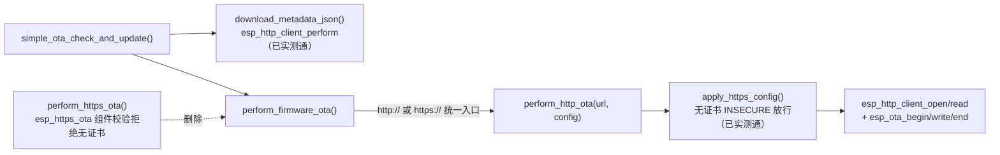

## 产品概述
ESP32-S3 老化网关固件 OTA 升级链路修复：服务器已迁移到 `https://192.168.40.116:7088/api/OTAFiles/Download?fileName=xxx` HTTPS 接口后，元数据（update.json）下载已实测跑通，但固件 bin 下载被 `esp_https_ota` 组件自带的证书校验拦截（`No option for server verification is enabled in esp_http_client config` → `ESP_ERR_INVALID_ARG`）。

## 核心功能
- **根因修复**：`esp_https_ota` 的 `is_server_verification_enabled()`（IDF 源码 esp_https_ota.c:269-297）只接受 `cert_pem`/`use_global_ca_store`/`crt_bundle_attach` 之一，不接受无证书 HTTPS（`skip_cert_common_name_check` 不在列）；而本工程的无证书 HTTPS 策略在 `esp_http_client` 通路已被元数据下载实测证明可用。修复：固件下载统一走 `esp_http_client` 手动 OTA 通路（`perform_http_ota` + `apply_https_config`），该通路 scheme 无关、对 http/https 均适用。
- **删除 OTA 文件中的未使用函数**（用户明确要求，仅限 OTA 文件）：通路统一后 `perform_https_ota()` 成为唯一未使用函数，连同 `#include "esp_https_ota.h"` 一并删除；其余函数经引用计数核实均有实际调用，`ota.h` 宏与公开 API 均在用，不动。
- **文档同步**：`OTA_SERVER_MIGRATION_DESIGN.md` 追加本次根因（esp_https_ota 校验）与通路统一的修复记录。
- **烧录提示（非代码问题）**：设备日志 `Current firmware version: 0.0.0` 是因为顶层 `build/` 目录缓存配置为 0.0.0（07:50，早于 version.txt 改为 0.0.1），用户用 plain `idf.py` 烧录的是顶层产物；需用规定命令（`-B build/mesh-lite -D SDKCONFIG=build/mesh-lite/sdkconfig`）重新烧录，首条日志应为 `Current firmware version: 0.0.1`。

## Tech Stack Selection
- 平台：ESP-IDF v5.4.4 / ESP32-S3 / C，复用工程现有 `esp_http_client` + `esp_ota_ops`，不引入新组件、不改 sdkconfig（`CONFIG_ESP_HTTPS_OTA_ALLOW_HTTP` 标注 ONLY FOR TESTING，不启用）
- 修改范围：`main/APP/OTA/ota.c`（通路统一 + 删未使用函数）、`OTA_SERVER_MIGRATION_DESIGN.md`（记录）

## Implementation Approach
**策略**：通路统一 + 最小删除。`perform_firmware_ota()` 不再按 scheme 分发到 `esp_https_ota`，http/https 均走已验证的 `perform_http_ota()`；给 `perform_http_ota()` 增加 `const simple_ota_config_t *config` 参数并在 init 前调用 `apply_https_config()`，使无证书 HTTPS / cert_pem / bundle 三种策略在固件下载通路与元数据通路完全一致。

关键决策：
1. **不启用 `CONFIG_ESP_HTTPS_OTA_ALLOW_HTTP`**：IDF help 明确 "ONLY FOR TESTING PURPOSE"，且会放宽全局 HTTPS 语义；本工程已有可用的 esp_http_client 无证书通路，无需动 sdkconfig。
2. **不提供证书**：上一任务用户已决策无证书 insecure（内网 IP + 与 GetMissingIdNums 同主机先例）。
3. **删除而非保留 `perform_https_ota`**：用户明确要求删除 OTA 文件中未使用函数；通路统一后其功能被 `perform_http_ota` 完全覆盖（esp_https_ota 相对手动通路仅剩便利性，且其校验与本工程策略冲突）。

可靠性与性能：
- 固件下载仍为 2048 字节缓冲边读边写 + 进度日志 + 长度校验（`perform_http_ota` 既有逻辑），超时 15s；元数据 10s。无新增任务/队列/内存分配。
- 服务器 bin 2036944 字节 < ota 分区 0x240000；URL 最长约 185 字节 < 512。

## Implementation Notes
- `perform_http_ota()` 新签名需传 config；其内 `esp_http_client_config_t` 增加 `.skip_cert_common_name_check = config->skip_cert_common_name_check`，并调用 `apply_https_config(&http_config, config)`，返回值必须检查（规范 ERR33-C）。
- 日志文案 `Starting HTTP OTA` 改为 scheme 中性的 `Starting OTA download`，避免 https 场景误导。
- `perform_firmware_ota()` 保留 `http://`/`https://` 前缀白名单校验，其余 scheme 维持 `ESP_ERR_NOT_SUPPORTED`。
- 删除 `perform_https_ota` 后确认 `esp_https_ota.h` include 无其他使用者；`is_https_url()` 仍被 `apply_https_config()` 使用，保留。
- 构建必须用规定命令（`-B build/mesh-lite -D SDKCONFIG=build/mesh-lite/sdkconfig`），勿用顶层过期 `build/`。

## Architecture Design

## Agent Extensions
### Skill
- **embedded-coding-standard**
  - Purpose: 编译验证前按工程 `.ai/coding-standard.md`（本地规范权威）与已确认规则组合（`.em_skill.json`：CERT C + FreeRTOS + Local coding standard）审查本次 C 改动：`perform_http_ota` 新增 config 参数与 `apply_https_config` 返回值处理、删除函数后的引用完整性（无悬空 include/调用）、错误路径非空、日志文案与命名一致性。
  - Expected outcome: 改动符合本地嵌入式 C 规范，无返回值丢失、无未使用代码残留，形成可追溯审查记录后进入编译。
