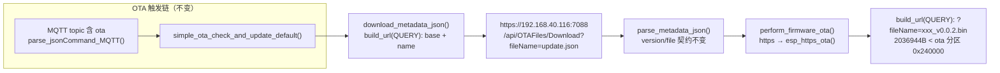
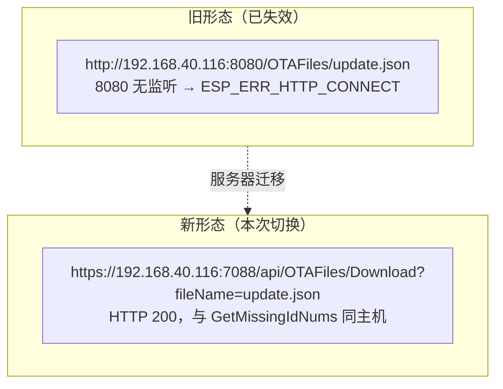

## 产品概述
ESP32-S3 电池老化网关固件的 OTA 升级链路改造：服务器已下线 8080 静态目录服务，OTA 文件（update.json 与固件 bin）迁移到 7088 端口的 HTTPS REST 下载接口。本次完成根因确认、设备侧接口适配与版本号对齐，使 MQTT 下发的 ota 指令恢复可用。

## 核心功能
- **根因确认（已完成调研）**：设备侧 `ESP_ERR_HTTP_CONNECT`/`Connection reset by peer` 与 PC 侧 curl(7) 连不上 8080 相互印证——192.168.40.116:8080 无监听，旧静态目录地址整体失效，非设备代码缺陷；OTA 文件服务已迁移为 `https://192.168.40.116:7088/api/OTAFiles/Download?fileName=<文件名>`（与已在用的 GetMissingIdNums 同主机同端口）。
- **URL 构造改造**：`ota.c` 的 `build_url()` 从单一「目录+文件名」拼接扩展为双风格（PATH 目录拼接 / QUERY 查询串拼接），默认走 QUERY；`service_urls.h` 的 `LG_URL_OTA_BASE_URL` 切换为新 HTTPS API 地址。
- **HTTPS 证书策略放开**：`apply_https_config()` 在「无 cert_pem 且无 bundle」时，若 sdkconfig 已启用 `CONFIG_ESP_TLS_INSECURE` 则记 WRN 放行（与仓库内访问同一 7088 主机的 `test_http_post_record_query()` 先例一致），否则维持报错；默认配置显式声明 `skip_cert_common_name_check=true`。
- **版本号对齐**：`version.txt` 由四段 `0.0.1.13` 改为三段 `0.0.1`（`parse_semver()` 严格要求 MAJOR.MINOR.PATCH，四段会在读取本地版本处直接失败，永远走不到下载）。
- **文档同步**：新建设计文档记录根因/证据/接口改造/验证步骤；AGENTS.md「OTA 升级」节中过时的 `http://10.16.160.51:8888/OTABin/` 描述同步更新。


## Tech Stack Selection
- 语言/平台：C（ESP-IDF v5.4.4，ESP32-S3），复用工程现有 `esp_http_client` / `esp_https_ota` 双通路，不引入新组件
- 修改范围：`main/APP/OTA/ota.c`、`main/APP/OTA/ota.h`、`main/Task/service_urls.h`、`version.txt`、文档（`AGENTS.md` + 新设计文档）
- 构建：`cd /home/wbb/espidf/esp-idf-mesh-lite && . ./export.sh && cd /home/wbb/espidfProject/ESP32Aging && IDF_SKIP_CHECK_SUBMODULES=1 idf.py -B build/mesh-lite -D SDKCONFIG=build/mesh-lite/sdkconfig build`
- 验证手段：编译 + 串口观察（工程无测试套件）；C 改动按 `.ai/coding-standard.md` 用 embedded-coding-standard skill 审查（工程 `.em_skill.json` 已配置 CERT C + FreeRTOS + Local coding standard）

## Implementation Approach
**策略**：最小侵入 + 向后兼容。不改动 update.json 解析契约（version/file 两字段）、不改 `validate_firmware_filename()` 防目录跳转规则、不改 `perform_firmware_ota()` 的 scheme 分发逻辑（新 URL 是 https://，自动走 `esp_https_ota()` 通路）。

关键决策与取舍：
1. **URL 风格用枚举而非模板字符串**：在 `simple_ota_config_t` 增加 `url_style` 字段（PATH=旧目录拼接，QUERY=查询串拼接）。比「%s 模板」改动小、比「base 末尾嗅探」可测试；保留 PATH 使回退旧服务器（http://10.16.160.51:8888/OTABin/）只需改一个配置值。
2. **无证书 HTTPS 放行条件挂在编译期开关上**：`#ifdef CONFIG_ESP_TLS_INSECURE` 才放行并打 WRN，sdkconfig 关闭该选项时维持 `ESP_ERR_INVALID_ARG`——把「允许不安全连接」的决策显式绑定到构建配置，避免静默降级。
3. **版本号对齐服务器而非放宽解析器**：`parse_semver()` 三段式是 AGENTS.md 记载的线上契约（服务器端同样是三段），放宽到四段会双边改协议；version.txt 改 `0.0.1` 后与服务器当前版本一致（比较相等→跳过升级，服务器发 0.0.2+ 才触发）。

性能与可靠性：
- 新 URL 最长约 57+128=185 字节 < `SIMPLE_OTA_URL_MAX_LEN`(512)，无缓冲区风险；服务器 bin 2036944 字节 < ota 分区 0x240000(2359296)，可装入。
- 元数据仍走 `esp_http_client_perform()`（10s 超时），固件走 `esp_https_ota()`（15s 超时）；404 时服务器返回 JSON 错误体，现有 `status_code != 200` 检查已能捕获并返回 ESP_FAIL。
- 无新增任务/队列/内存分配，热路径零影响。

## Implementation Notes
- `build_url()` QUERY 分支必须**原样拼接**（base 已含 `?fileName=`），并在 `validate_config()` 对 QUERY 风格增加「base 必须含 `://` 和 `?`」的防呆校验，避免配置写错时生成 `…Download?fileName=/update.json` 这类脏 URL。
- `apply_https_config()` 放行分支要打 WRN 日志（含 URL 前缀），保证现场可识别「本次是不安全连接」；cert_pem/bundle 优先的既有优先序不变。
- `simple_ota_check_and_update_default()` 是 MQTT ota 指令的唯一入口，默认配置改为 `url_style=QUERY, use_crt_bundle=false, cert_pem=NULL, skip_cert_common_name_check=true`；`simple_ota_check_and_update()` 接受外部 config 的调用方行为不变（默认枚举值 0 = PATH，保持向后兼容）。
- 修改 version.txt 后必须重新编译（构建系统经 CMAKE_CONFIGURE_DEPENDS 跟踪）；OTA 地址是编译期常量，需 app-flash 或完整 flash（不改 data/，无需重烧 SPIFFS）。
- 日志防刷屏：沿用现有 `ESP_LOGI("Checking OTA metadata: %s")` / `ESP_LOGI("Firmware URL: %s")` 打点，便于串口核对实际生成的 URL。

## Architecture Design





## Directory Structure
```
ESP32Aging/
├── OTA_SERVER_MIGRATION_DESIGN.md   # [NEW] 设计文档：根因分析/实测证据/接口改造/兼容性/实机验收
├── version.txt                      # [MODIFY] 0.0.1.13 → 0.0.1（三段式对齐服务器）
├── AGENTS.md                        # [MODIFY] 「OTA 升级」节 LG_URL_OTA_BASE_URL 过时描述同步
└── main/
    ├── Task/
    │   └── service_urls.h            # [MODIFY] LG_URL_OTA_BASE_URL 改为 https://192.168.40.116:7088/api/OTAFiles/Download?fileName= （注释说明新形态）
    └── APP/OTA/
        ├── ota.h                    # [MODIFY] simple_ota_url_style_t 枚举 + simple_ota_config_t 增加 url_style 字段（默认 0=PATH 兼容）
        └── ota.c                    # [MODIFY] build_url() 按风格分支；validate_config() QUERY 防呆；apply_https_config() 无证书 HTTPS 在 CONFIG_ESP_TLS_INSECURE 下放行+WRN；simple_ota_check_and_update_default() 显式配置
```

## Key Code Structures

```c
/* ota.h：URL 拼接风格（默认值 0 = PATH，保证既有调用方行为不变） */
typedef enum {
    SIMPLE_OTA_URL_STYLE_PATH = 0,  /**< 目录拼接：base + '/' + name（旧静态目录形态） */
    SIMPLE_OTA_URL_STYLE_QUERY      /**< 查询串拼接：base + name（base 已含 "?fileName="） */
} simple_ota_url_style_t;

/* simple_ota_config_t 末尾新增字段 */
simple_ota_url_style_t url_style;

/* service_urls.h：新 OTA 下载接口（与 LG_URL_Get_LOST_IDNUM_URL 同主机同端口） */
#define LG_URL_OTA_BASE_URL "https://192.168.40.116:7088/api/OTAFiles/Download?fileName="
```


## Agent Extensions
### Skill
- **embedded-coding-standard**
  - Purpose: 在编译验证前，按工程 `.ai/coding-standard.md`（本地规范权威）与已确认规则组合（`.em_skill.json`：CERT C + FreeRTOS + Local coding standard）审查本次 C 改动：`build_url()` 双风格分支的缓冲区与返回值处理、`validate_config()` 新增防呆校验、`apply_https_config()` 编译期条件放行的错误路径、配置结构体新增字段的兼容性、URL 长度与 snprintf 截断。
  - Expected outcome: 改动符合本地嵌入式 C 规范，无返回值丢失、错误路径为空、魔法数等问题，形成可追溯审查记录后再进入编译。
