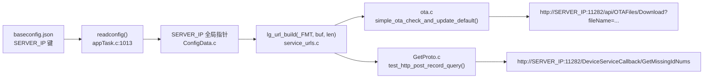

## 产品概述
将 OTA 元数据/固件下载接口与缺失数据补发接口的服务器 IP 从编译期硬编码改为运行时取自 `baseconfig.json` 的 `SERVER_IP`（与 MQTT broker 同一机制），换服务器以后只改配置、无需重新编译烧录。

## 核心功能
- `service_urls.h`：`LG_URL_OTA_BASE_URL` / `LG_URL_Get_LOST_IDNUM_URL` 由完整 URL 宏改为 IP 占位模板（`_FMT` 后缀，scheme+端口+路径仍为编译期常量），新增 `LG_URL_MAX_LEN` 与 `lg_url_build()` 声明；同步过时注释（7088→11282）
- 新增 `main/Task/service_urls.c`：`lg_url_build()` 用运行时 `SERVER_IP` 填充模板到调用方缓冲区；`SERVER_IP` 为空或缺失默认值 `"default"` 时返回 `ESP_ERR_INVALID_STATE`
- 调用点改造：`ota.c`（`simple_ota_check_and_update_default`）与 `GetProto.c`（`test_http_post_record_query`）改用本地缓冲构建 URL，构建失败记错误日志并返回错误码
- `main/CMakeLists.txt` 登记新源文件；`AGENTS.md`「OTA 升级」节「地址为编译期常量」表述同步为「IP 运行时取自 SERVER_IP，端口/路径仍编译期常量」
- `LG_URL_HTTP_PROTOCOL_WHOLE_URL`（公网域名形态）不改


## Tech Stack Selection
- 语言/平台：C（ESP-IDF v5.4.4 / ESP32-S3），复用现有 `SERVER_IP` 配置机制与 `esp_http_client`，不引入新组件、不改 sdkconfig
- 修改范围：`main/Task/service_urls.h`、`main/Task/service_urls.c`（新增）、`main/CMakeLists.txt`、`main/APP/OTA/ota.c`、`main/APP/HTTP/GetProto.c`、`AGENTS.md`

## Implementation Approach
**策略**：宏保留「除 IP 以外的全部内容」并以 `%s` 占位 IP；单一构建函数 `lg_url_build(fmt, out, size)` 用 `SERVER_IP` 填充；调用方传本地缓冲——无静态缓冲、无锁、无竞态，完全对齐 MQTT 侧 `SERVER_IP` 运行时化的既有先例。

关键决策与取舍：
1. **宏改名 `_FMT` 而非保留旧名**：IP 运行时化后宏不再是完整 URL 字符串，保留旧名会误导后续维护者；全仓引用点仅 2 处代码 + 若干注释/文档，一次性改完。
2. **调用方传缓冲而非返回静态缓冲指针**：两个调用点分属 mqtt_rx 任务与老化任务上下文，返回静态缓冲构成隐藏共享状态（违反本地规范「共享状态必须同步」）；本地缓冲天然无竞态，256B 栈开销可忽略。
3. **校验缺失配置哨兵 `"default"`**：`readconfig()` 对缺失键的默认值就是 `"default"`（appTask.c:1013），据此识别未配置并返回 `ESP_ERR_INVALID_STATE`，由调用方记错误日志——与 MQTT 连不上时的失败模式一致，不静默降级。
4. **端口/路径不做运行时化**：用户只要求 IP 取自 SERVER_IP；端口路径保持编译期常量，后续如需配置化可在 baseconfig.json 加键扩展。

性能与可靠性：
- `snprintf` 带截断检查；URL 最长约 63 字符，`LG_URL_MAX_LEN=256` 余量充足；无新增任务/队列/锁/堆分配，热路径零影响
- `SERVER_IP` 在 `readconfig()` 后指向 appTask.c 静态缓冲全程有效；两处调用均在配置加载之后（MQTT 指令 / 老化 DataCheck 阶段）

## Implementation Notes
- `service_urls.c` 需 `#include "ConfigData.h"`（`ConfigData` 目录已在 INCLUDE_DIRS）；新文件只需在 CMakeLists SRCS 加一行
- `ota.c`：本地 `char base_url[LG_URL_MAX_LEN]` 传给 `.base_url`；`config` 在同一函数栈帧内使用，生命周期安全；最终 URL 仍在 `download_metadata_json()` 的 `metadata_url[SIMPLE_OTA_URL_MAX_LEN]` 中生成，两者层次不要混淆
- `GetProto.c`：本地 `char url[LG_URL_MAX_LEN]` 供 `esp_http_client_config_t.url` 使用
- 错误路径不得为空：builder 失败 → `ESP_LOGE` + 原错误码返回，中断本次 OTA 检查/补发查询
- `service_urls.h` 头部使用约定注释同步更新（原「这里只放地址本身」补充运行时构建说明）

## Architecture Design



## Directory Structure
```
ESP32Aging/
├── main/
│   ├── CMakeLists.txt              # [MODIFY] SRCS 增加 "Task/service_urls.c"
│   ├── Task/
│   │   ├── service_urls.h          # [MODIFY] 两宏改 _FMT 模板（%s 占位 IP）+ LG_URL_MAX_LEN + lg_url_build 声明 + 注释同步
│   │   └── service_urls.c          # [NEW] lg_url_build 实现：SERVER_IP 填充 + 缺失校验 + snprintf 截断检查
│   ├── APP/OTA/ota.c               # [MODIFY] 默认配置 base_url 改本地缓冲运行时构建（ota.h:46 注释同步）
│   └── APP/HTTP/GetProto.c         # [MODIFY] GetMissingIdNums URL 改本地缓冲运行时构建
└── AGENTS.md                       # [MODIFY] OTA 节「编译期常量」表述改为 IP 运行时化说明
```

## Key Code Structures

```c
/* service_urls.h：IP 运行时化模板（%s 由 lg_url_build 用 SERVER_IP 填充） */
#define LG_URL_OTA_BASE_URL_FMT        "http://%s:11282/api/OTAFiles/Download?fileName="
#define LG_URL_GET_LOST_IDNUM_URL_FMT  "http://%s:11282/DeviceServiceCallback/GetMissingIdNums"
#define LG_URL_MAX_LEN                 256

/* url_fmt 必须且只能含一个 %s（IP 占位）；out 由调用方提供，函数只写不保留引用 */
esp_err_t lg_url_build(const char *url_fmt, char *out, size_t out_size);
```

调用形态（ota.c / GetProto.c 一致）：

```c
char url[LG_URL_MAX_LEN];
esp_err_t err = lg_url_build(LG_URL_XXX_URL_FMT, url, sizeof(url));
if (err != ESP_OK) {
    ESP_LOGE(TAG, "Build service URL failed: %s", esp_err_to_name(err));
    return err;
}
```


## Agent Extensions
### Skill
- **embedded-coding-standard**
  - Purpose: 在编译验证前，按工程 `.ai/coding-standard.md`（本地规范权威）与 `.em_skill.json` 已确认规则组合（CERT C + FreeRTOS + Local coding standard）审查本次 C 改动：新增 `service_urls.c` 的返回值处理/错误路径/缓冲区与截断检查、`SERVER_IP` 外部指针的 NULL 与哨兵校验、两个调用点本地栈缓冲的生命周期与错误处理、宏改名后全仓引用完整性（无残留旧宏名）。
  - Expected outcome: 改动符合本地嵌入式 C 规范，无返回值丢失、错误路径为空、隐藏共享状态或引用残留，形成可追溯审查记录后再进入编译。
