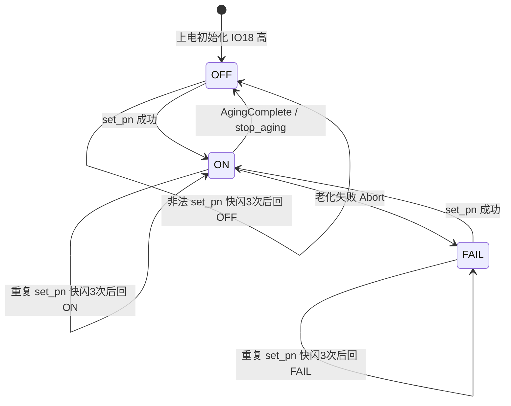
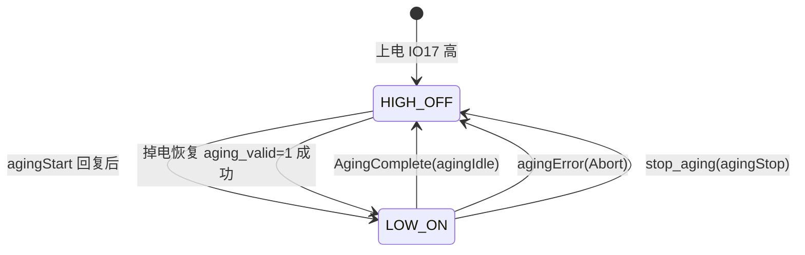
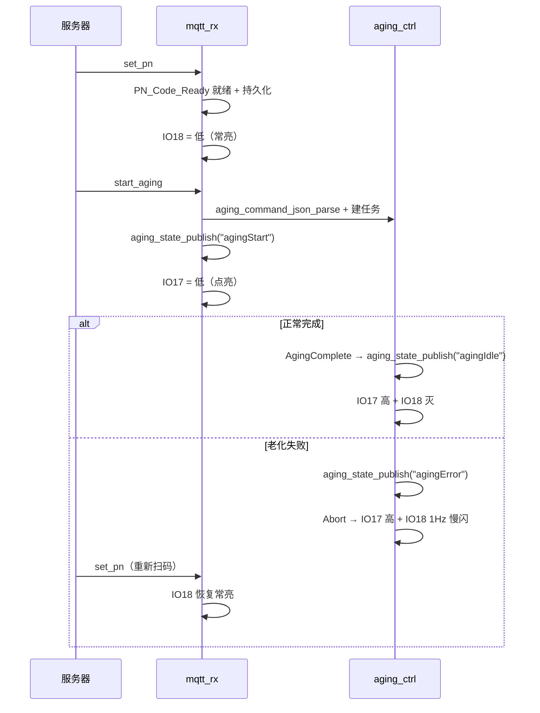

## 产品概述
为老化测试网关新增两路低电平点亮的指示灯：IO18 显示 PN 状态，IO17 显示老化运行状态。

## 核心功能

### 1. IO18：PN 状态灯
- PN 设置成功：常亮，表示 PN 已就绪待启动
- 重复设置 PN：快闪 3 次（200 ms 周期）后恢复事件前的稳态；覆盖老化运行中拒绝、已有未消费 Ready PN 拒绝、空/超长非法 PN 拒绝三种情况
- 老化失败：1 Hz 慢闪，并一直保持到下一次 set_pn 成功（不自动熄灭）
- 正常老化结束：熄灭
- 上电/无 PN：熄灭；老化运行期间保持常亮（PN 仍在用）

### 2. IO17：老化运行灯
- 老化正常启动并回复 agingStart 后：拉低点亮
- 老化结束（正常完成 agingIdle、异常 agingError、人工 stop_aging）后：恢复高电平
- 掉电重启自动恢复到运行中的老化（aging_valid=1）时：上电即点亮

## 视觉与行为要求
两灯均低电平点亮，初始化阶段不得出现上电瞬间误亮；快闪与慢闪节奏稳定、互不干扰；状态切换与 MQTT 状态上报在同一代码点完成。


## 技术栈
- C（贴合工程 c99 风格）、ESP-IDF v5.4.4、FreeRTOS 双核
- `driver/gpio.h` 直接输出，不引入 ledc / rmt / esp_timer
- 沿用工程模块化方式：`main/APP/` 下新增独立模块，`appTask.c` 作为编排层只插入事件钩子
- 新文件必须手工加入 `main/CMakeLists.txt` 的 `SRCS` 与 `INCLUDE_DIRS`（不自动 glob）

## 实现方案

### 核心决策
1. **独立 LED 模块 + 事件接口**：GPIO 操作与闪烁状态机全部收敛在 `status_led.c`，`appTask.c` 只在既有状态出口插入一行调用。理由：老化失败有 13 处 `aging_state_publish("agingError")`，但统一收口在 `Aging_Task_Abort_And_Delete()`，集中挂接可避免新增分支遗漏；后续改灯效只动一个模块。
2. **50 ms 轮询任务驱动 IO18**，与既有 `button_task` 同模型（同优先级 1、CPU1），避免 esp_timer 回调里做状态机的隐含约束；栈 2048、优先级 1，空转开销可忽略。
3. **IO17 纯电平、事件点直接写 GPIO**：不经过任务调度，保证「agingStart 发布后立即拉低」的时序，也避免掉电恢复时灯亮滞后。
4. **原子变量而非临界区**：状态用 `atomic_int`（工程已在 `appTask.c` 用 `stdatomic`），`mqtt_rx` / `aging_ctrl` / `net_init` 三个任务并发调用无锁、无阻塞。
5. **不新增 NVS 字段**：失败指示保存在 RAM，随重启清零（重启后由 `aging_valid` / Ready PN 恢复路径决定灯态），避免额外 flash 磨损。

### 状态机（IO18）


### 状态机（IO17）


### 时序


### 性能与可靠性
- 每 tick O(1)：读两个原子变量、最多一次电平翻转；无动态内存、无 NVS 写入、无阻塞
- 仅初始化与状态迁移打 `ESP_LOGI`（低频），50 ms tick 内禁止打印
- 所有事件接口可重入、幂等（重复调用同一事件结果一致）
- 不触碰协议键名、分区表、sdkconfig 与任务布局，爆炸半径限定在新增模块 + 钩子行

## 关键实现细节

### 1. 上电防误亮
GPIO 输出锁存器可先写值再使能方向：先 `gpio_set_level(17, 1); gpio_set_level(18, 1);` 锁存高电平，再 `gpio_config()` 配成输出，避免配置瞬间拉低导致灯闪一下。

### 2. 钩子注入点（`main/Task/appTask.c`）
| 场景 | 位置 | 动作 |
|---|---|---|
| 初始化 | `app_task_init()` 在 `app_uart_init()` 之前 | `status_led_init()` |
| PN 成功 | 3117 `publish_pn_reply(seq,1,...)` 之后 | `status_led_pn_ready()` |
| 重复：RUNNING | 3082-3084 | `status_led_pn_reject()` |
| 重复：已有 Ready PN | 3089-3091 | `status_led_pn_reject()` |
| 非法：空/超长 | 3101-3103、3104-3108 | `status_led_pn_reject()` |
| 老化启动 | 2450 `aging_state_publish("agingStart")` 之后 | `status_led_aging_start()` |
| 正常完成 | `case AgingComplete` 内 `vTaskDelete(NULL)` 之前 | `status_led_aging_stop(); status_led_pn_off();` |
| 老化失败 | `Aging_Task_Abort_And_Delete()` 中 `vTaskDelete(NULL)` 之前 | `status_led_aging_stop(); status_led_pn_fail();` |
| 人工停止 | stop_aging 分支 3065 之后 | `status_led_aging_stop(); status_led_pn_off();` |
| 恢复 Ready PN | 3557-3560 成功分支 | `status_led_pn_ready()` |
| 恢复运行中老化 | 3579-3580 清 Ready PN 处 | `status_led_pn_off()` |
| 恢复成功 | 3605-3607 `state=RUNNING` | `status_led_aging_start()` |

### 3. 边界约定（实现时必须遵守）
- 老化运行期间不清 IO18：`start_aging_with_ready_pn()` 里 `clear_ready_pn_runtime()` 不联动熄灯，否则「正常结束熄灭」无可见变化
- 缺 PN 拒绝（`reject_start_aging_missing_pn`，含 `agingError`）不改动 IO18 稳态，它不属于老化失败
- MQTT Seq 去重命中时只重放回复、不进业务分支，因此不触发快闪
- 老化失败后 `stop_aging` 因 `Aging_test_task_handle == NULL` 不会执行，失败指示自然保留到下次 `set_pn`
- 根节点不执行 Ready PN / 运行中老化恢复（既有 `IsRoot == 1` 提前 break），其上电为双灯熄灭
- `status_led_aging_stop()` 幂等，老化启动前失败也能安全调用

### 4. 编译与回归
- `main/CMakeLists.txt` 增加 `APP/Status/status_led.c` 与 `APP/Status` 目录，否则链接期符号缺失
- 宿主机测试沿用 `tests/` 现有「真实 C 源码 + mock SDK」方式（参考 `tests/test_cpu_usage.py`），mock `driver/gpio.h` 与 FreeRTOS 任务 API
- 实机验证：`idf.py -p /dev/ttyUSB0 app-flash` 后按四场景逐项核对灯效

## 目录结构

```
main/
├── APP/
│   └── Status/                          # [NEW] 目录
│       ├── status_led.h                 # [NEW] 状态灯接口与引脚宏
│       └── status_led.c                 # [NEW] GPIO 初始化、50ms 轮询任务、快闪/慢闪状态机
├── Task/
│   ├── appTask.c                        # [MODIFY] 引入 status_led.h，在 12 个钩子点插入事件调用
│   └── task_config.h                    # [MODIFY] 新增 LG_STACK_STATUS_LED / LG_PRIO_STATUS_LED
└── CMakeLists.txt                       # [MODIFY] SRCS 增加 APP/Status/status_led.c，INCLUDE_DIRS 增加 APP/Status
tests/
└── test_status_led.py                   # [NEW] 宿主机 mock 测试：初始化电平、常亮、快闪 3 次回落、慢闪、幂等
STATUS_LED_DESIGN.md                     # [NEW] 时序图、状态迁移表、钩子清单与验收步骤
```

## 关键接口

```c
/* main/APP/Status/status_led.h */
#define STATUS_LED_AGING_GPIO   17   /* 老化运行灯，低电平点亮 */
#define STATUS_LED_PN_GPIO      18   /* PN 状态灯，低电平点亮 */

typedef enum {
    STATUS_LED_PN_OFF = 0,   /* 稳态熄灭 */
    STATUS_LED_PN_ON,        /* 稳态常亮 */
    STATUS_LED_PN_FAIL,      /* 稳态 1Hz 慢闪，保持到下次 set_pn 成功 */
} status_led_pn_mode_t;

esp_err_t status_led_init(void);          /* 配置 GPIO、锁存高电平、创建轮询任务 */
void      status_led_aging_start(void);   /* IO17 拉低 */
void      status_led_aging_stop(void);    /* IO17 拉高（幂等） */
void      status_led_pn_ready(void);      /* IO18 稳态常亮 */
void      status_led_pn_reject(void);     /* IO18 快闪 3 次后回到原稳态 */
void      status_led_pn_fail(void);       /* IO18 稳态 1Hz 慢闪 */
void      status_led_pn_off(void);        /* IO18 稳态熄灭 */
```


## Agent Extensions

### Skill
- **embedded-coding-standard**
  - Purpose: 按工程 `.ai/coding-standard.md` 与 CERT C / FreeRTOS 约束审查新增的 `status_led.c/h` 与 `appTask.c` 钩子改动（原子变量使用、GPIO 初始化顺序、临界区长度、幂等性、日志规范）
  - Expected outcome: 输出逐条问题清单与修复建议，确认无阻塞调用、无竞态、无上电误亮，并在审查通过后再做编译验证
