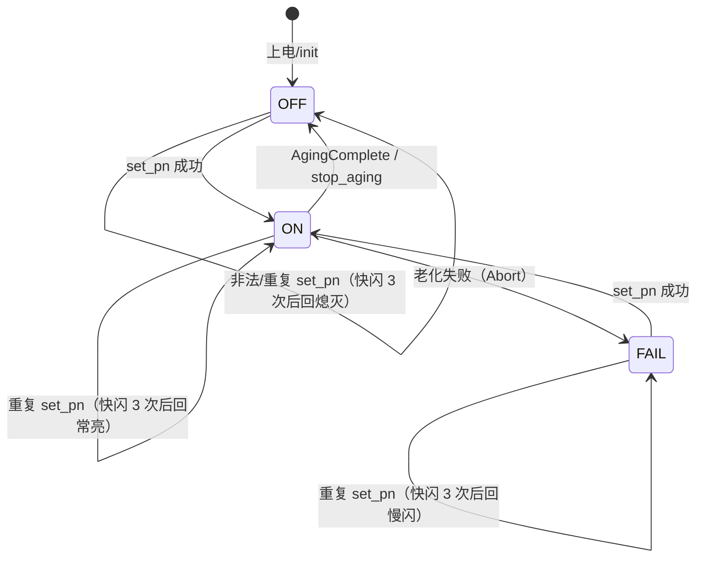
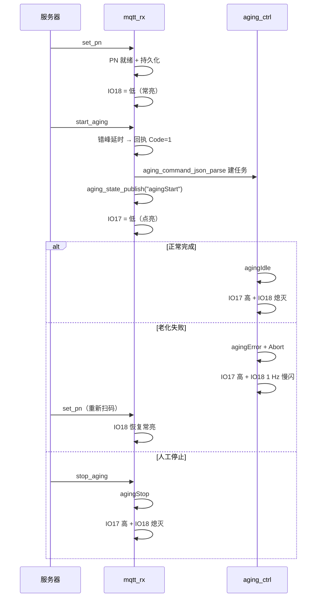

# 状态指示灯设计（IO18 PN 状态 / IO17 老化运行）

## 1. 需求与结论

新增两路低电平点亮的单色指示灯：

| 引脚 | 语义 | 灯亮（低） | 灯灭（高） |
|---|---|---|---|
| IO18 | PN 状态 | 见第 3 节状态机 | 见第 3 节状态机 |
| IO17 | 老化运行 | 老化已启动（`agingStart` 已回复） | 空闲 / 已结束 |

两灯均**低电平点亮**，上电默认熄灭。GPIO17/18 与现有 UART（43/44）、RS485/CAN（1/2）、
以太网 SPI（6/15/7/16/4/5）、按键（40）均不冲突。

## 2. 引脚与模块

- 驱动模块：`main/APP/Status/status_led.c` / `.h`（新增）
- 任务：`status_led`，CPU1，栈 `LG_STACK_STATUS_LED`（2048），优先级 `LG_PRIO_STATUS_LED`（1），
  周期 50 ms；仅驱动 IO18 的闪烁，IO17 由事件点直接写电平
- 初始化：`app_task_init()` 在 `app_uart_init()` 之前调用 `status_led_init()`，失败只写日志不阻断启动
- 编译：`main/CMakeLists.txt` 的 `SRCS` 增加 `APP/Status/status_led.c`，`INCLUDE_DIRS` 增加 `APP/Status`

## 3. IO18（PN 状态灯）规则

### 3.1 稳态与临时状态

| 稳态 | 输出 | 进入条件 | 退出条件 |
|---|---|---|---|
| `OFF` 熄灭 | 高 | 上电；无有效 PN；老化正常结束；人工 stop | `set_pn` 成功 |
| `ON` 常亮 | 低 | `set_pn` 成功；老化运行期间保持（PN 仍在用） | 正常结束 / stop / 老化失败 |
| `FAIL` 1 Hz 慢闪 | 亮 500 ms / 灭 500 ms | 老化会话异常终止（`agingError` 收口） | 下次 `set_pn` 成功 |

临时状态：**快闪**（亮 200 ms / 灭 200 ms × 3 次，共 1200 ms）只覆盖输出，不改变稳态；
结束后必定回到事件前的稳态。快闪期间再次触发则从头重闪。

### 3.2 四类场景

| 场景 | 代码位置（`main/Task/appTask.c`） | 动作 |
|---|---|---|
| PN 设置成功 | `set_pn` 分支 `publish_pn_reply(seq, 1, PN_Code_Ready)` 之后 | `status_led_pn_ready()` → 常亮 |
| 重复：老化运行中 | 同分支 `AGING_CMD_RUNNING` 拒绝 | `status_led_pn_reject()` → 快闪 3 次后回常亮 |
| 重复：已有未消费 Ready PN | 同分支 `s_new_pn_ready == 1` 拒绝 | 同上（回到常亮） |
| 重复/非法：空 PN、超长 PN | 同分支两个参数校验失败 | 同上（回到事件前稳态，通常为熄灭） |
| 老化失败 | `Aging_Task_Abort_And_Delete()` | `status_led_pn_fail()` → 1 Hz 慢闪，保持到下次 `set_pn` 成功 |
| 正常老化结束 | `case AgingComplete` | `status_led_pn_off()` → 熄灭 |
| 人工停止 | `stop_aging` 分支 | `status_led_pn_off()` → 熄灭 |

### 3.3 状态机



### 3.4 时序参数

| 参数 | 值 | 说明 |
|---|---|---|
| 轮询周期 | 50 ms | `STATUS_LED_TICK_MS` |
| 快闪半周期 | 200 ms | `STATUS_LED_FAST_HALF_MS`，4 个 tick 翻转 |
| 快闪次数 | 3 | `STATUS_LED_FAST_COUNT`，总时长 1200 ms |
| 慢闪周期 | 1000 ms | `STATUS_LED_SLOW_PERIOD_MS`，亮 500 ms |

## 4. IO17（老化运行灯）时序

| 事件 | 代码位置 | 动作 |
|---|---|---|
| 老化正常启动并回复 `agingStart` | `start_aging_with_ready_pn()` 的 `aging_state_publish("agingStart")` 之后 | 拉低（点亮） |
| 掉电恢复运行中老化成功 | `Init_ByNetwork_Flag`：`aging_command_json_parse()` 成功、`state=RUNNING` | 上电即点亮 |
| 掉电恢复失败（数据缺失/解析失败） | 同上失败分支 | 保持/恢复高电平 |
| 正常完成 `agingIdle` | `case AgingComplete` | 恢复高电平 |
| 异常终止 `agingError` | `Aging_Task_Abort_And_Delete()` | 恢复高电平 |
| 人工 `stop_aging`（`agingStop`） | `stop_aging` 分支 | 恢复高电平 |



## 5. 上电与恢复

1. `status_led_init()` 先向输出锁存器写高（灭），再 `gpio_config()` 切输出方向，最后再次锁存高电平，
   避免配置瞬间误亮。
2. 子节点 `Init_ByNetwork_Flag` 恢复 Ready PN 成功 → IO18 常亮；无有效 Ready PN → 确认熄灭。
3. `aging_valid == 1` 且恢复成功 → IO17 点亮、IO18 常亮（当前 PN 仍在使用）。
   恢复失败 → 双灯熄灭。
4. 根节点按既有逻辑跳过 Ready PN / 运行中老化恢复，其上电为双灯熄灭。
5. 失败指示（慢闪）只保存在 RAM：重启后由上述恢复路径重新决定灯态，不额外写 NVS。

## 6. 边界与约定

| # | 约定 |
|---|---|
| 1 | 老化运行期间不清 IO18：`start_aging_with_ready_pn()` 消费 Ready PN 时不联动熄灯，否则“正常结束熄灭”无可见变化 |
| 2 | `reject_start_aging_missing_pn()` 虽发 `agingError`，但**不改动 IO18 稳态**：它不属于老化会话失败 |
| 3 | MQTT Seq 去重命中只重放回复、不进业务分支，因此不触发快闪 |
| 4 | 老化失败后 `stop_aging` 因 `Aging_test_task_handle == NULL` 不执行，失败指示自然保留到下次 `set_pn` |
| 5 | 所有事件接口幂等、可重入、无阻塞；临界区只做赋值/自增（`portMUX_TYPE`） |
| 6 | 轮询任务创建失败时降级：IO18 常亮/熄灭立即生效，慢闪退化为熄灭，快闪不生效 |
| 7 | 50 ms tick 内不打印日志；仅在状态迁移与初始化打日志 |

## 7. 测试与验收

### 7.1 宿主机回归

```bash
python3 tests/test_status_led.py
ASAN_OPTIONS=detect_leaks=0 TEST_SANITIZE=1 python3 tests/test_status_led.py
```

覆盖：上电两次“灭”电平早于 `gpio_config`、两脚位掩码、IO17 电平与幂等、IO18 常亮、
常亮/熄灭/慢闪三种稳态下的快闪 3 次回落、1 Hz 慢闪相位、任务创建失败降级。

### 7.2 实机验收

| # | 操作 | 期望 |
|---|---|---|
| 1 | 上电 | 双灯熄灭（无闪亮） |
| 2 | 下发 `set_pn` | IO18 常亮 |
| 3 | 老化运行中再次 `set_pn` | IO18 快闪 3 次后回常亮，回复 Code=0 |
| 4 | 再次 `set_pn`（Ready PN 未消费） | 同上 |
| 5 | 下发 `start_aging` | IO17 点亮，`event/state` 为 `agingStart` |
| 6 | 老化正常跑完 | IO17 熄灭、IO18 熄灭，`agingIdle` |
| 7 | 拔掉老化设备制造 `agingError` | IO17 熄灭、IO18 1 Hz 慢闪 |
| 8 | 失败后重新 `set_pn` | IO18 转常亮，慢闪停止 |
| 9 | 运行中 `stop_aging` | IO17 熄灭、IO18 熄灭，`agingStop` |
| 10 | 运行中掉电重启 | 恢复成功后 IO17 立即点亮、IO18 常亮 |
